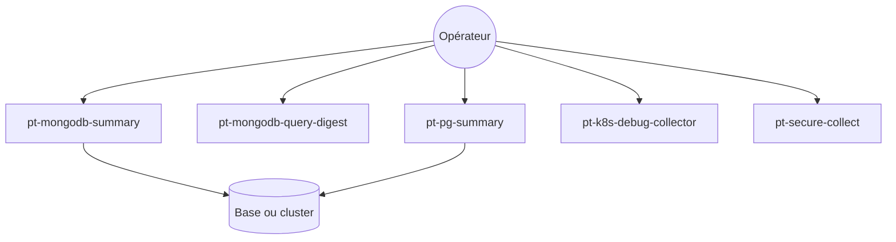

# percona/percona-toolkit

> Collection d'outils en ligne de commande de Percona pour diagnostiquer MySQL, MongoDB, PostgreSQL et le système.

## Le problème
Diagnostiquer une base de données (requêtes lentes, index inutilisés, réplication Galera) demande des scripts maison fragiles, jamais testés ni documentés.

## Ce que ça fait vraiment
Des outils autonomes, développés par le support de Percona. Le code Go présenté couvre : résumé et digest de requêtes MongoDB, vérification d'index inutilisés, résumé PostgreSQL, explication de logs Galera, collecte de debug Kubernetes et collecte sécurisée (nettoyage puis chiffrement d'un bundle de support).

## Comment c'est branché


## Essayer
```bash
man percona-toolkit
man tool
```
L'installation passe par le dépôt Percona, une archive ou la compilation : voir le fichier INSTALL.

## Coût et pièges
Gratuit. Il faut un accès à la base ou au cluster visé. Les bugs se déclarent dans le Jira de Percona avec la ligne de commande, la version et la sortie d'erreur.

## Ce que ce n'est pas
Ce n'est pas une plateforme de supervision continue : ce sont des outils ponctuels lancés à la main. Ce n'est pas un seul programme, mais des outils séparés.

## Alternatives
Aucune alternative nommée dans le README.

## Pour toi
À surveiller : utile si tu administres MySQL, MongoDB ou PostgreSQL derrière tes pipelines de données, sans intérêt direct pour des modèles ; la licence GPL-2.0 n'est un souci que si tu redistribues le code.

