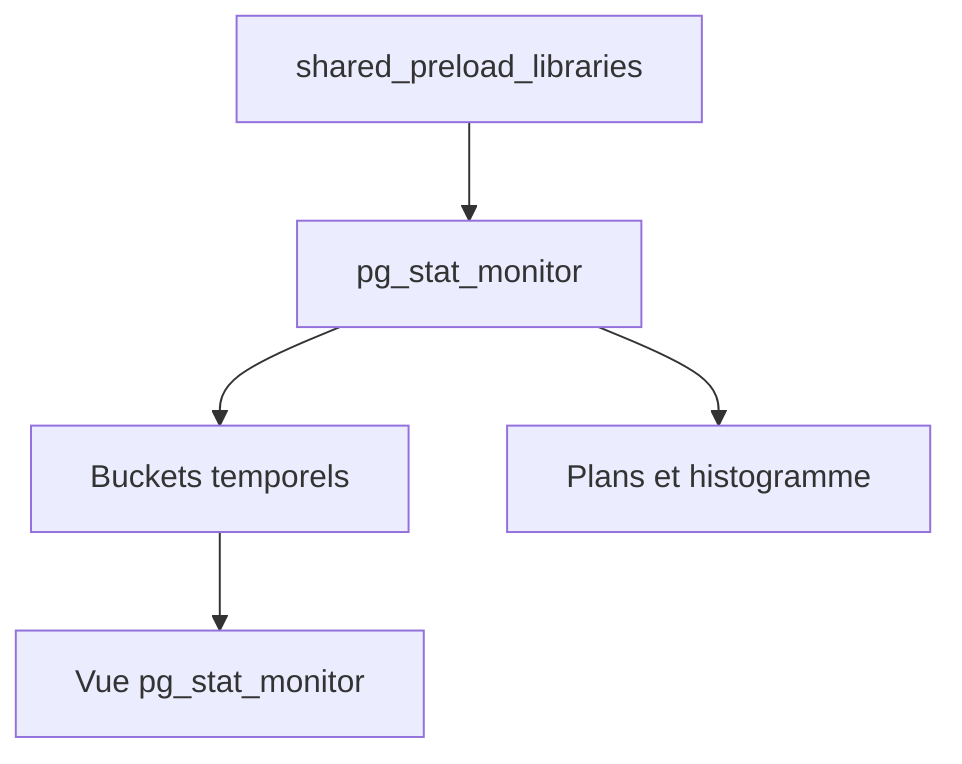

# percona/pg_stat_monitor

> PostgreSQL extension for query performance monitoring by time slices, an advanced replacement for pg_stat_statements.

## The problem
pg_stat_statements only shows ever-increasing counters: hard to isolate a degradation over a short period.

## What it actually does
The extension aggregates statistics into configurable time "buckets", with finer grouping (client_ip, application). It can capture the actual query parameters, the execution plan, the tables accessed and a histogram of timings. PostgreSQL 14 and later.

## How it is wired


## Trying it
```bash
percona-release setup ppg-17
apt-get install percona-pg-stat-monitor17
```
```sql
ALTER SYSTEM SET shared_preload_libraries = 'pg_stat_monitor';
CREATE EXTENSION pg_stat_monitor;
```

## Cost and gotchas
Free. PostgreSQL must be restarted, the extension created per database by a superuser, and all modules listed in `shared_preload_libraries`. License not identified by GitHub.

## What it is not
Not a dashboard: it provides a SQL view. Used together with pg_stat_statements, the memory and WAL statistics become inconsistent.

## Alternatives
- pg_stat_statements: native, simpler, no time windows.

## For you
Watch: useful if you run PostgreSQL for MLOps, of no interest otherwise.
