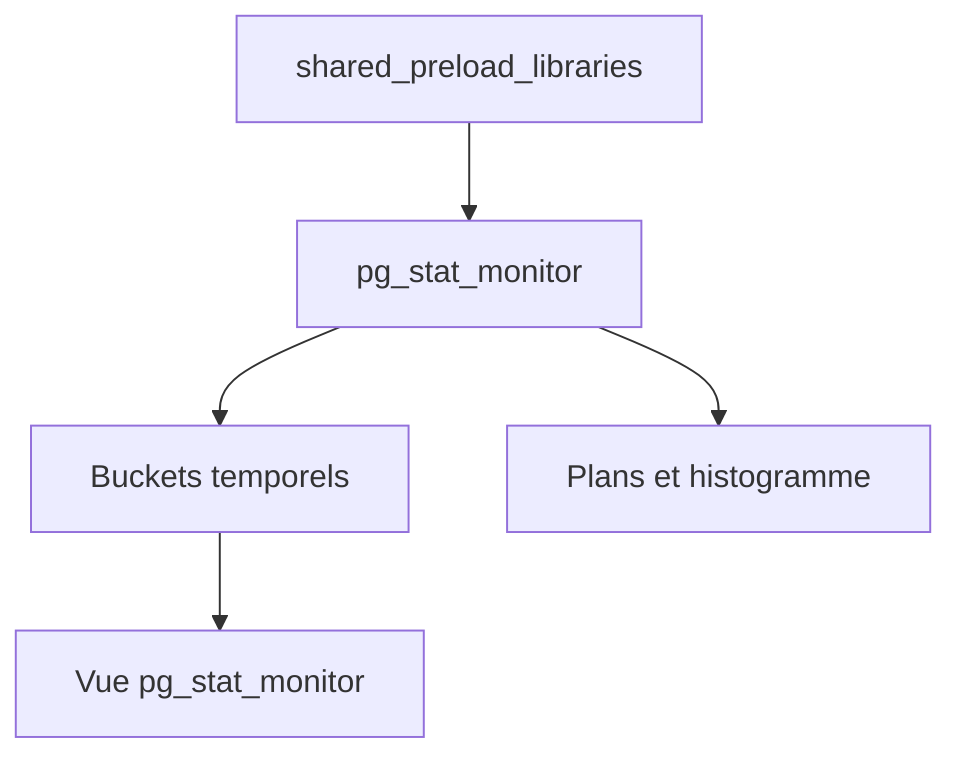

# percona/pg_stat_monitor

> Extension PostgreSQL de suivi des performances de requêtes, par tranches de temps, remplaçante avancée de pg_stat_statements.

## Le problème
pg_stat_statements n'affiche que des compteurs croissants : difficile d'isoler une dégradation sur une courte période.

## Ce que ça fait vraiment
L'extension agrège les statistiques dans des « buckets » temporels configurables, avec un regroupement plus fin (client_ip, application). Elle peut capturer les paramètres réels des requêtes, le plan d'exécution, les tables accédées et un histogramme des temps. PostgreSQL 14 et plus.

## Comment c'est branché


## Essayer
```bash
percona-release setup ppg-17
apt-get install percona-pg-stat-monitor17
```
```sql
ALTER SYSTEM SET shared_preload_libraries = 'pg_stat_monitor';
CREATE EXTENSION pg_stat_monitor;
```

## Coût et pièges
Gratuit. Il faut redémarrer PostgreSQL, créer l'extension par base avec un superuser, et lister tous les modules dans `shared_preload_libraries`. Licence non identifiée par GitHub.

## Ce que ce n'est pas
Pas un tableau de bord : elle fournit une vue SQL. Utilisée avec pg_stat_statements, les statistiques de mémoire et de WAL deviennent incohérentes.

## Alternatives
- pg_stat_statements : natif, plus simple, sans fenêtres temporelles.

## Pour toi
Surveiller : utile si tu exploites PostgreSQL pour du MLOps, sans intérêt autrement.

