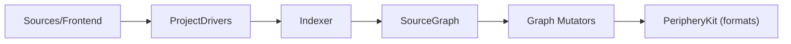

# peripheryapp/periphery

> A tool that detects unused Swift code; the open-source repository is now archived and the product has become commercial.

## The problem
Swift projects accumulate dead classes, parameters and imports that are hard to spot.

## What it actually does
Builds the project to produce the index store, constructs an in-memory graph of declarations and their references, marks the entry points, then walks the graph to find unreferenced declarations. Detects unused parameters, redundant protocols, enum cases, properties assigned but never read, superfluous `public`, and unused imports. Supports Xcode, SwiftPM and Bazel.

## How it is wired


## Trying it
```bash
brew install periphery
periphery scan --setup
periphery scan
```

## Cost and gotchas
The README announces the transition to a commercial product; this repository is kept as a historical record and archived (last push August 2026). Issues have moved to another repository.

## What it is not
Not maintained here: development happens elsewhere, outside the MIT license of the archived repository. False positives are possible with Objective-C, compile-time macros, Codable.

## Alternatives
None named in the README.

## For you
Ignore: a Swift/iOS tool, archived and now paid.
