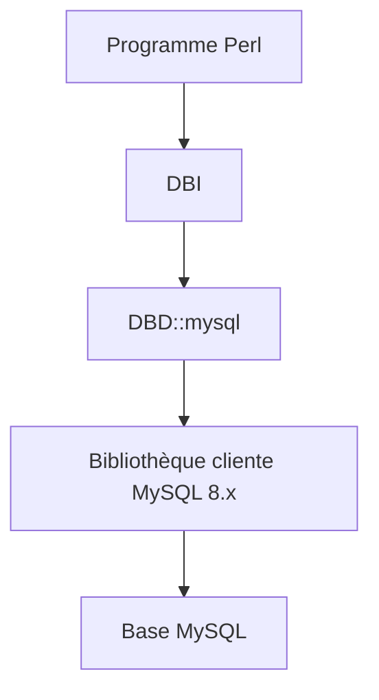

# perl5-dbi/DBD-mysql

> Perl DBI driver for accessing MySQL and compatible databases.

## The problem
Perl programs need a DBI driver to talk to MySQL.

## What it actually does
The README is minimal: it is the Perl DBI driver for MySQL. Usage is described in the DBD::mysql documentation page and installation in DBD::mysql::INSTALL. Building requires the MySQL 8.x or newer client library.

## How it is wired
Simplified diagram based on the sheet, no diagram provided.



## Trying it
```bash
perl Makefile.PL
make
make test
```

## Cost and gotchas
Perl and a compiler are required, along with the MySQL 8.x or newer client library. Database credentials are set according to the output of perl Makefile.PL. The license is not identified by GitHub.

## What it is not
It is not an ORM or a command-line client, only a DBI driver. Detailed usage is not in the README.

## Alternatives
- No alternative named in the README.

## For you
Ignore: only useful if you maintain Perl code against MySQL, which is rare in a data / AI / MLOps profile.
