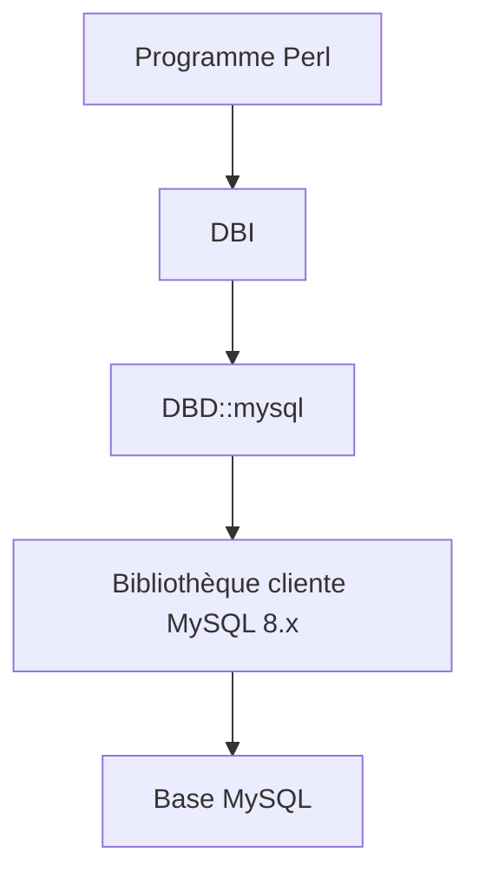

# perl5-dbi/DBD-mysql

> Pilote Perl DBI pour accéder à MySQL et aux bases compatibles.

## Le problème
Les programmes Perl ont besoin d'un pilote DBI pour parler à MySQL.

## Ce que ça fait vraiment
Le README est minimal : c'est le driver DBI de Perl pour MySQL. L'usage est décrit dans la page de documentation DBD::mysql et l'installation dans DBD::mysql::INSTALL. La construction demande la bibliothèque cliente MySQL 8.x ou plus récente.

## Comment c'est branché
Schéma simplifié d'après la fiche, sans diagramme fourni.



## Essayer
```bash
perl Makefile.PL
make
make test
```

## Coût et pièges
Perl et un compilateur sont nécessaires, avec la bibliothèque cliente MySQL 8.x ou plus. Les identifiants de base se règlent selon la sortie de perl Makefile.PL. La licence n'est pas identifiée par GitHub.

## Ce que ce n'est pas
Ce n'est pas un ORM ni un client en ligne de commande, seulement un pilote DBI. L'usage détaillé n'est pas dans le README.

## Alternatives
- Aucune alternative nommée dans le README.

## Pour toi
À ignorer : utile seulement si tu maintiens du code Perl face à MySQL, ce qui est rare dans un profil data / IA / MLOps.

