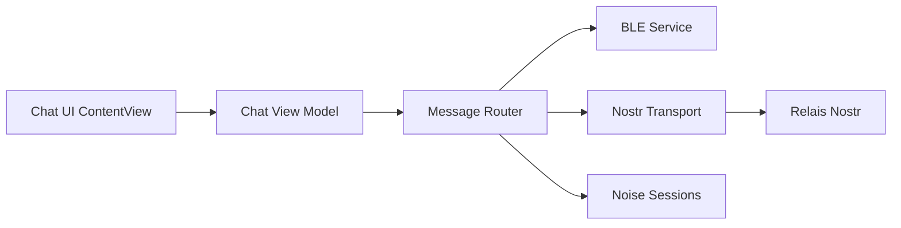

# permissionlesstech/bitchat

> Peer-to-peer messaging with no account and no server, via an offline Bluetooth mesh and Nostr relays over the Internet.

## The problem
Communicating when the Internet is cut off or monitored, without a phone number or a central server.

## What it actually does
A message router picks the transport: first multi-hop Bluetooth LE mesh (7 hops maximum, Noise encryption), then Nostr relays as a fallback, with geographic channels by geohash. Private messages over Nostr use an envelope format specific to bitchat, incompatible with the standard NIPs. The application targets iOS and macOS.

## How it is wired


## Trying it
```bash
open bitchat.xcodeproj
cp Configs/Local.xcconfig.example Configs/Local.xcconfig
swift test
brew install just
just check
just run
```

## Cost and gotchas
Free. Building requires Xcode and an Apple Developer team ID for a signed build. The mesh uses a persistent device identifier, which the README acknowledges. Do not install binaries of unknown origin: the repository has been the subject of takedown requests.

## What it is not
It is not anonymous in the strict sense: a nearby radio receiver can observe metadata. Coverage remains that of the surrounding Bluetooth neighborhood.

## Alternatives
No alternative named in the README.

## For you
Worth watching: a topic of curiosity (mesh, Noise encryption) with no direct use for data/AI work; young project, created in July 2025.
