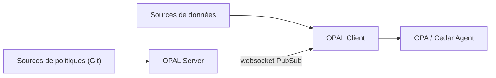

# permitio/opal

> Administration layer that pushes policies and data in real time to OPA or Cedar engines.

## The problem
Open Policy Agent enforces policies well, but keeping them in sync with the application's data state is left to you.

## What it actually does
Stateless client-server architecture: the OPAL server watches for changes (Git, APIs, databases, S3) and publishes on a PubSub channel over websocket; OPAL clients, subscribed by topic, fetch the data at the source and load it into their engine (OPA or Cedar Agent). Extension points: data fetch providers.

## How it is wired


## Trying it
```bash
curl -L https://raw.githubusercontent.com/permitio/opal/master/docker/docker-compose-example.yml > docker-compose.yml && docker compose up
```

## Cost and gotchas
Free; Docker or Python packages; Helm chart for Kubernetes. You already need a policy engine (OPA or Cedar). OPAL is the engine behind the paid Permit.io service.

## What it is not
Not a policy engine: it synchronizes, it does not decide. The usage figures in the README (10,000 engines, etc.) come from the authors.

## Alternatives
No alternative named in the README (OPToggles and Cedar-Agent are complements).

## For you
Watch: useful if you already run OPA on your platform and permissions change quickly; otherwise premature.
