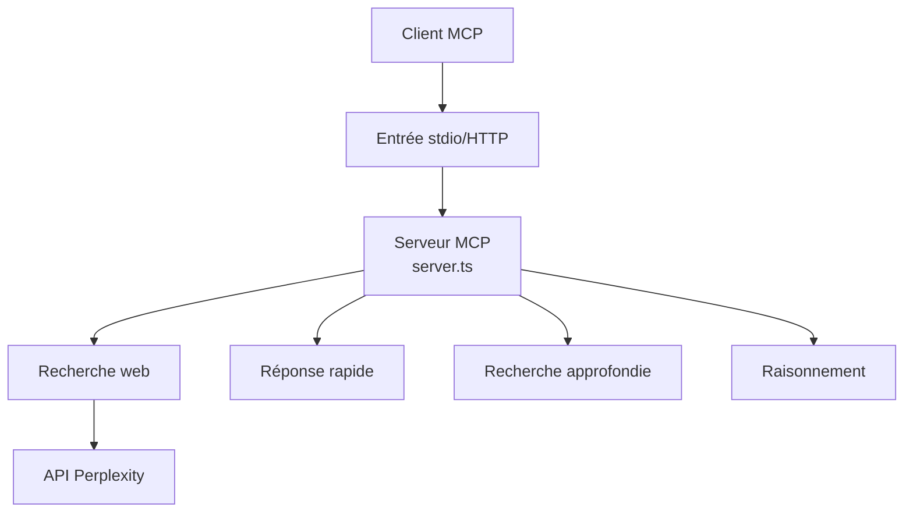

# perplexityai/modelcontextprotocol

> Perplexity's official MCP server that gives an AI assistant web search, quick answers and deep research.

## The problem
An AI assistant without web access remains limited to its frozen knowledge and cannot verify or look up recent information.

## What it actually does
Exposes four MCP tools: `perplexity_search` (direct web search), `perplexity_ask` (quick answer), `perplexity_research` (streaming deep research) and `perplexity_reason` (advanced reasoning), all backed by Perplexity's Agent API or Search API. Can run as a hosted remote server or locally (stdio/HTTP).

## How it is wired


## Trying it
```bash
claude mcp add perplexity --env PERPLEXITY_API_KEY="your_key_here" -- npx -y @perplexity-ai/mcp-server
```

## Cost and gotchas
Requires a Perplexity API key, billed for this usage. The remote server avoids installation but transmits the key through the authorization header.

## What it is not
Not a search engine of its own: it relays calls to Perplexity's Agent API and Search API. No longer includes the old `strip_thinking`/`reasoning_effort` parameters, which are ignored if sent.

## Alternatives
No alternative named in the README.

## For you
Adopt for a data/AI agent that needs reliable web search with dated sources, if the Perplexity API key budget is acceptable.
