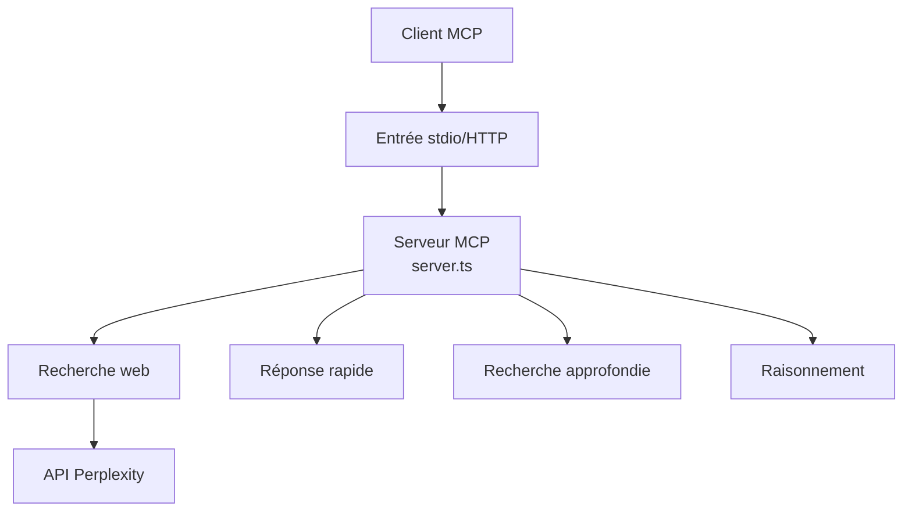

# perplexityai/modelcontextprotocol

> Serveur MCP officiel de Perplexity qui donne à un assistant IA la recherche web, la réponse rapide et la recherche approfondie.

## Le problème
Un assistant IA sans accès web reste limité à ses connaissances figées et ne peut pas vérifier ou chercher une information récente.

## Ce que ça fait vraiment
Expose quatre outils MCP : `perplexity_search` (recherche web directe), `perplexity_ask` (réponse rapide), `perplexity_research` (recherche approfondie en streaming) et `perplexity_reason` (raisonnement avancé), tous appuyés sur l'Agent API ou la Search API de Perplexity. Peut tourner en serveur distant hébergé ou en local (stdio/HTTP).

## Comment c'est branché


## Essayer
```bash
claude mcp add perplexity --env PERPLEXITY_API_KEY="your_key_here" -- npx -y @perplexity-ai/mcp-server
```

## Coût et pièges
Nécessite une clé d'API Perplexity, facturée par cet usage. Le serveur distant évite l'installation mais transmet la clé via l'en-tête d'autorisation.

## Ce que ce n'est pas
Pas un moteur de recherche propre : il relaie les appels vers l'Agent API et la Search API de Perplexity. N'inclut plus les anciens paramètres `strip_thinking`/`reasoning_effort`, ignorés s'ils sont envoyés.

## Alternatives
Aucune alternative nommée dans le README.

## Pour toi
À adopter pour un agent data/IA qui a besoin de recherche web fiable avec sources datées, si le budget clé d'API Perplexity est accepté.

