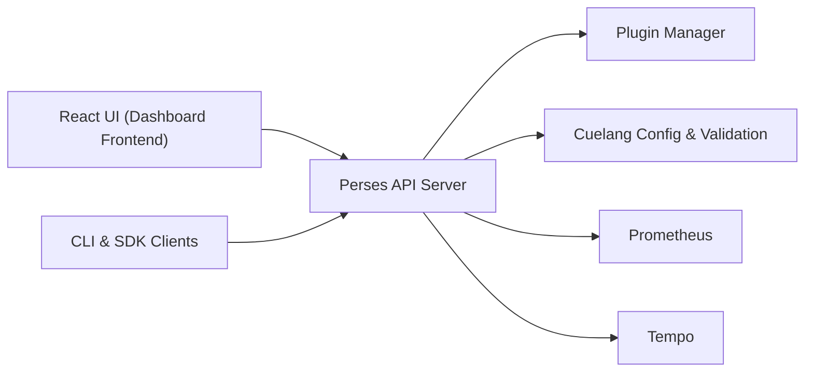

# perses/perses

> Observability dashboard tool (Prometheus, Tempo, Loki, Pyroscope) with dashboards as code.

## The problem
Monitoring dashboards are built by hand in the interface; they are hard to version and to share between tools.

## What it actually does
Go server and React interface. Displays metrics, traces, logs and profiles. Open dashboard specification, validated with CUE; `percli` CLI, Go and CUE SDKs for GitOps; plugins; native Kubernetes mode through an operator; authentication and authorizations. CNCF Sandbox project.

## How it is wired


## Trying it
```bash
docker run --name perses -d -p 127.0.0.1:8080:8080 persesdev/perses
brew install perses/tap/perses
make build
./bin/perses --config=your_config.yml
```

## Cost and gotchas
Free. Building from source requires Go 1.26, Node 22 and npm 10. Data sources (Prometheus, Tempo, etc.) must be provided. 274 open issues; public demo available.

## What it is not
Not a collector or a metrics store: it displays data coming from elsewhere.

## Alternatives
No alternative named in the README.

## For you
Worth watching: interesting for monitoring MLOps services with versioned dashboards; if Grafana is enough for you, the gain is thin.
