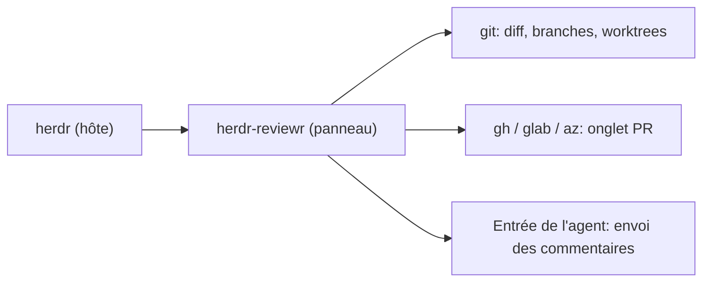

# persiyanov/herdr-reviewr

> Code review panel for herdr: read the agent's diff, comment on lines, send them back.

## The problem
Reviewing what a coding agent changed, without leaving the terminal, then returning precise remarks to it.

## What it actually does
Colored diff in unified or side-by-side views, four scopes (uncommitted, branch, last turn, commits), comments on lines or ranges sent to the agent in one go. It adds a file viewer, search, a read-only PR tab and 20 themes. It never modifies files.

## How it is wired
Simplified diagram based on the sheet, no diagram provided.



## Trying it
```bash
herdr plugin install persiyanov/herdr-reviewr
herdr plugin action invoke open --plugin persiyanov.reviewr
herdr-reviewr ~/some/repo
```

## Cost and gotchas
Free. Requires herdr 0.9.3 or later, git and a 24-bit terminal. Unsent comments are lost when the panel is closed.

## What it is not
Not a standalone tool: without herdr, sending and the "last turn" scope do not work. It posts nothing to the PR.

## Alternatives
No alternative cited in the README.

## For you
Watch: useful only if you use herdr to drive coding agents; otherwise of no interest.
