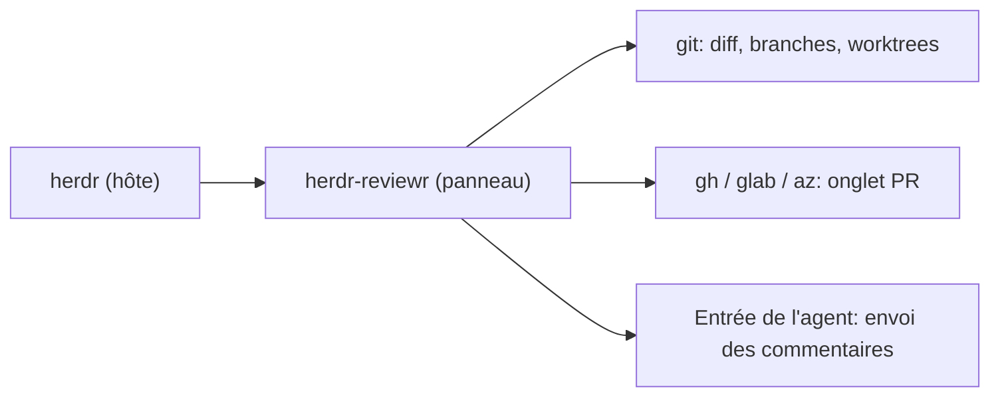

# persiyanov/herdr-reviewr

> Panneau de revue de code pour herdr : lire le diff de l'agent, commenter les lignes, renvoyer.

## Le problème
Relire ce qu'un agent de code a modifié, sans quitter le terminal, puis lui retourner des remarques précises.

## Ce que ça fait vraiment
Diff coloré en vues unifiée ou côte à côte, quatre portées (non commité, branche, dernier tour, commits), commentaires sur lignes ou plages envoyés d'un coup à l'agent. Il ajoute visionneuse de fichiers, recherche, onglet de PR en lecture seule et 20 thèmes. Il ne modifie jamais les fichiers.

## Comment c'est branché
Schéma simplifié d'après la fiche, sans diagramme fourni.



## Essayer
```bash
herdr plugin install persiyanov/herdr-reviewr
herdr plugin action invoke open --plugin persiyanov.reviewr
herdr-reviewr ~/some/repo
```

## Coût et pièges
Gratuit. Exige herdr 0.9.3 ou plus, git et un terminal 24 bits. Les commentaires non envoyés sont perdus à la fermeture du panneau.

## Ce que ce n'est pas
Pas un outil autonome : sans herdr, l'envoi et la portée « dernier tour » ne marchent pas. Il ne poste rien sur la PR.

## Alternatives
Aucune alternative citée dans le README.

## Pour toi
Surveiller : utile seulement si tu utilises herdr pour piloter des agents de code ; sinon sans intérêt.

