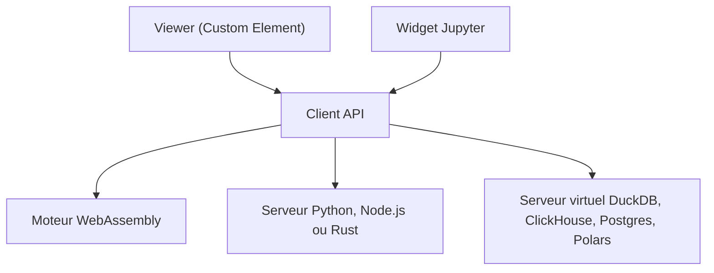

# perspective-dev/perspective

> Grid, pivot table and chart component for massive real-time data, in the browser or on the server.

## The problem
Displaying and manipulating large streaming datasets interactively forces you to assemble a grid, charts and a query engine.

## What it actually does
Provides a web element (editable grid, 15+ chart types, maps) and a streaming query engine written in C++, compiled to WebAssembly, or bound to Python, Node.js and Rust. The same client connects locally, in a Web Worker or over WebSocket. Virtual servers translate the view into DuckDB, ClickHouse, PostgreSQL or Polars queries. A Jupyter widget is provided.

## How it is wired


## Trying it
No installation command in the provided README; it points to the guide and to the `@perspective-dev/*` and `perspective` packages.
```bash
# non documenté dans le README fourni
```

## Cost and gotchas
Free, Apache-2.0. No key required. Large datasets in the browser require the 64-bit WebAssembly build.

## What it is not
Not a database nor a full BI tool: a component to integrate into an application or a notebook.

## Alternatives
None named in the README (DuckDB, ClickHouse, PostgreSQL and Polars appear there as pluggable engines).

## For you
Adopt: a good choice for exploring streaming data in Jupyter or an app, active project, under the OpenJS foundation.
