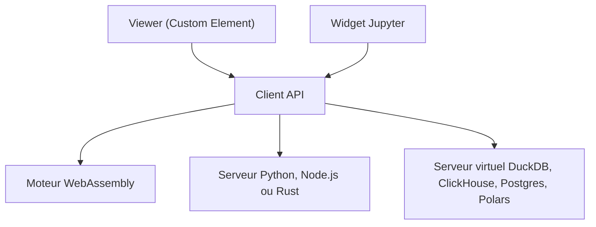

# perspective-dev/perspective

> Composant de grille, tableau croisé et graphiques pour données massives en temps réel, côté navigateur ou serveur.

## Le problème
Afficher et manipuler de gros jeux de données en flux, de façon interactive, oblige à assembler grille, graphiques et moteur de requêtes.

## Ce que ça fait vraiment
Fournit un élément web (grille éditable, 15+ types de graphiques, cartes) et un moteur de requêtes en flux écrit en C++, compilé en WebAssembly, ou lié à Python, Node.js et Rust. Le même client se connecte en local, dans un Web Worker ou par WebSocket. Des serveurs virtuels traduisent la vue en requêtes DuckDB, ClickHouse, PostgreSQL ou Polars. Un widget Jupyter est fourni.

## Comment c'est branché


## Essayer
Aucune commande d'installation dans le README fourni ; il renvoie au guide et aux paquets `@perspective-dev/*` et `perspective`.
```bash
# non documenté dans le README fourni
```

## Coût et pièges
Gratuit, Apache-2.0. Pas de clé requise. Les gros jeux en navigateur demandent la build WebAssembly 64 bits.

## Ce que ce n'est pas
Pas une base de données ni un outil de BI complet : un composant à intégrer dans une application ou un notebook.

## Alternatives
Aucune nommée dans le README (DuckDB, ClickHouse, PostgreSQL, Polars y figurent comme moteurs branchables).

## Pour toi
Adopter : bon choix pour explorer des données en flux dans Jupyter ou une appli, projet actif, sous la fondation OpenJS.

