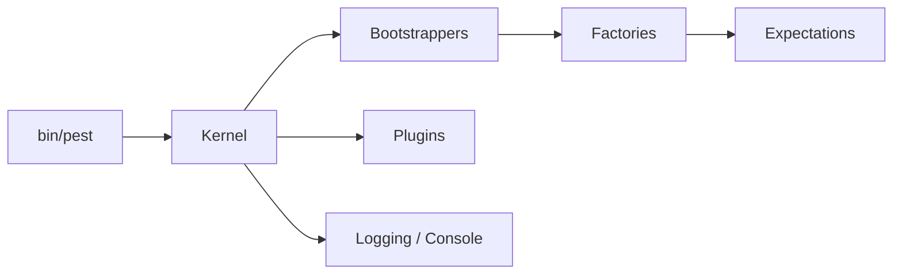

# pestphp/pest

> PHP testing framework with an elegant style, presented for developers and AI agents.

## The problem
Classic PHPUnit tests are verbose; the goal is to write readable tests faster.

## What it actually does
Very short README (announcement of Pest v5, links to the site and the creator's social networks). From the code: a `bin/pest` executable calls a Kernel and bootstrappers, loads configuration and architecture presets, creates tests via factories, evaluates expectations, and logs (console, TeamCity). A plugin system extends the whole.

## How it is wired

## Trying it
Not documented in this README: refers to pestphp.com.

## Cost and gotchas
Free. No visible hidden cost; depends on the PHP ecosystem.

## What it is not
Not a tool for testing models or data. The README describes neither installation nor features.

## Alternatives
No alternative named in the README.

## For you
Ignore: a PHP tool unrelated to your data/AI stack, and the README is too thin to judge further.
