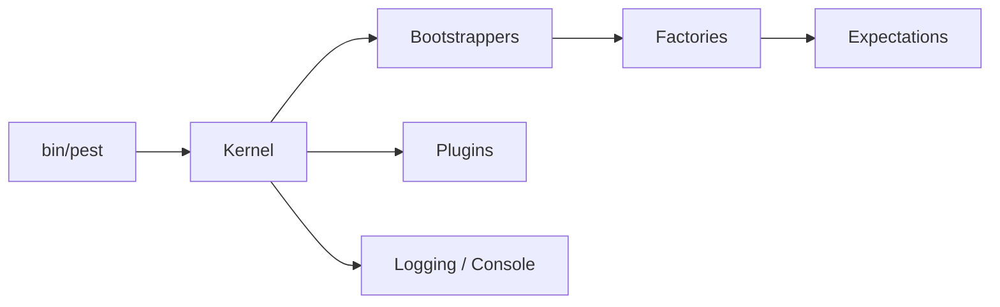

# pestphp/pest

> Framework de tests PHP au style élégant, présenté pour développeurs et agents IA.

## Le problème
Les tests PHPUnit classiques sont verbeux ; on veut écrire des tests lisibles plus vite.

## Ce que ça fait vraiment
README très court (annonce Pest v5, liens vers le site et les réseaux du créateur). D'après le code : un exécutable `bin/pest` appelle un Kernel et des bootstrappers, charge configuration et presets d'architecture, crée les tests via des factories, évalue des expectations, et journalise (console, TeamCity). Un système de plugins étend l'ensemble.

## Comment c'est branché

## Essayer
Non documenté dans ce README : renvoi à pestphp.com.

## Coût et pièges
Gratuit. Aucun coût caché visible ; dépend de l'écosystème PHP.

## Ce que ce n'est pas
Pas un outil de test de modèles ou de données. Le README ne décrit ni installation ni fonctionnalités.

## Alternatives
Aucune alternative nommée dans le README.

## Pour toi
À ignorer : outil PHP sans rapport avec ton stack data/IA, et README trop mince pour juger plus.

