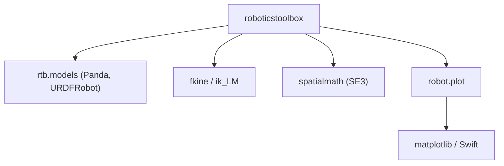

# petercorke/robotics-toolbox-python

> Python library for kinematics, dynamics and planning, for robotics research and teaching.

## The problem
Represent manipulator arms and mobile robots, and compute their motions, without rewriting the basic algorithms.

## What it actually does
Models serial-link robots (Denavit-Hartenberg form, URDF import, more than 50 models provided). Computes forward kinematics, the Jacobian and inverse kinematics. Also covers mobile robots: planning, localization, mapping. Visualization through matplotlib or the Swift browser simulator.

## How it is wired
Simplified diagram based on the sheet, no diagram provided.


## Trying it
```bash
pip install roboticstoolbox-python
pip install roboticstoolbox-python[all]
git clone https://github.com/petercorke/robotics-toolbox-python.git
cd robotics-toolbox-python
pip install -e .
```

## Cost and gotchas
Free. Python 3.10 or later. Swift is not supported on Windows without a patch, and `coal` has no Windows wheel on PyPI.

## What it is not
Not a reinforcement learning framework nor a full physics engine. The code favors readability over speed. Compatible with the MATLAB version, not a replacement for ROS.

## Alternatives
No alternative named in the README.

## For you
Ignore unless you have a robotics project: solid and well documented, but outside the usual data / AI / MLOps scope.
