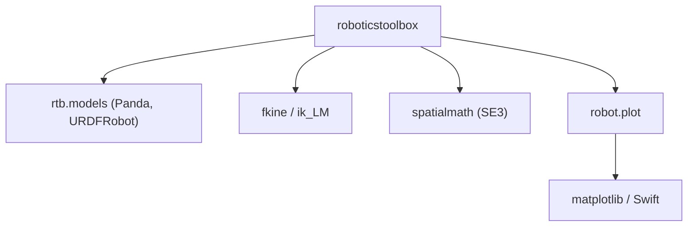

# petercorke/robotics-toolbox-python

> Bibliothèque Python de cinématique, dynamique et planification pour la recherche et l'enseignement en robotique.

## Le problème
Représenter des bras manipulateurs et des robots mobiles, et calculer leurs mouvements, sans réécrire les algorithmes de base.

## Ce que ça fait vraiment
Modélise des robots à liaisons série (forme Denavit-Hartenberg, import URDF, plus de 50 modèles fournis). Calcule cinématique directe, jacobienne et cinématique inverse. Couvre aussi les robots mobiles : planification, localisation, cartographie. Visualisation par matplotlib ou le simulateur navigateur Swift.

## Comment c'est branché
Schéma simplifié d'après la fiche, sans diagramme fourni.


## Essayer
```bash
pip install roboticstoolbox-python
pip install roboticstoolbox-python[all]
git clone https://github.com/petercorke/robotics-toolbox-python.git
cd robotics-toolbox-python
pip install -e .
```

## Coût et pièges
Gratuit. Python 3.10 ou plus. Swift n'est pas géré sous Windows sans correctif, et `coal` n'a pas de roue Windows sur PyPI.

## Ce que ce n'est pas
Pas un framework d'apprentissage par renforcement ni un moteur de physique complet. Le code privilégie la lisibilité à la vitesse. Compatible avec la version MATLAB, pas un remplaçant de ROS.

## Alternatives
Aucune alternative nommée dans le README.

## Pour toi
À ignorer sauf projet de robotique : solide et bien documenté, mais hors du périmètre data / IA / MLOps courant.

