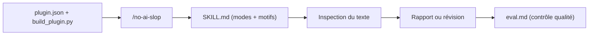

# petergyang/no-ai-slop

> Agent skill that removes twenty "AI" prose patterns from a text without erasing the author's voice.

## The problem
Texts generated or touched up by AI all look alike, and AI editing also flattens personal style.

## What it actually does
A `SKILL.md` file defines the pattern catalog (binary contrast, theatrical openers, false reveals, false depth…), the workflow and the report of changes. Three modes: edit, detect (cites the patterns without judging the author), generate "slop" as satire. `eval.md` serves as the checking criteria, and a ChatGPT/Codex plugin manifest is provided.

## How it is wired


## Trying it
```bash
npx skills add petergyang/no-ai-slop --skill no-ai-slop --global --yes
```
Then, in the agent: `/no-ai-slop (your writing)`.

## Cost and gotchas
Free; the tokens of the agent you use are on you. The result depends on the model running the skill.

## What it is not
Not an AI detector: it cites patterns and does not say whether a text is generated. It does not fix the substance.

## Alternatives
No alternative named in the README.

## For you
Worth watching: useful for proofreading notes and technical articles, but it is a recent writing tool maintained by a single person, so it has no impact on a data pipeline.
