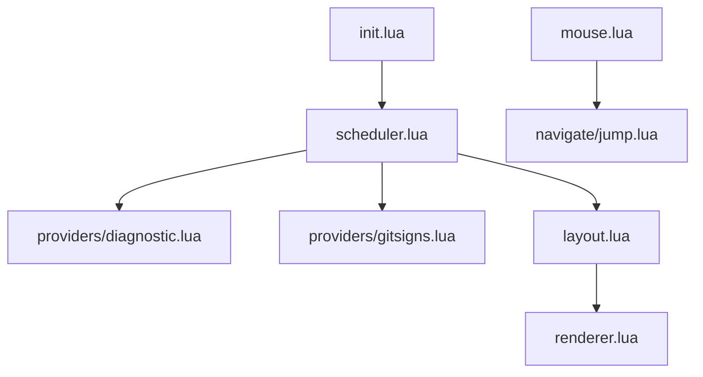

# petertriho/nvim-scrollbar

> Extensible scrollbar for Neovim, showing cursor, diagnostics, git and search.

## The problem
In Neovim, you cannot see where errors, git changes and search results are located in a long file.

## What it actually does
Draws a bar with marks: cursor, diagnostics (COC and native), ALE, git (gitsigns) and search (hlslens). You can register custom handlers that return lines to mark. According to the code: `init.lua` reads the config, `scheduler.lua` queries the providers, `layout.lua` projects, `renderer.lua` draws; mouse, minimap and `jump.lua` are used for navigation.

## How it is wired


## Trying it
```lua
use("petertriho/nvim-scrollbar")
require("scrollbar").setup()
```

## Cost and gotchas
Free. The README announces that v2 (November 16, 2026) changes the `setup()` options and requires Neovim 0.11; to keep v1, pin the `v1` branch or the `v1.0.0` tag. The README still mentions Neovim 0.5.1 as the minimum.

## What it is not
Not a code analysis tool: a visual layer for the editor.

## Alternatives
No alternative named in the README.

## For you
Worth watching only if you code in Neovim: useful comfort, but v2 breaks the configuration.
