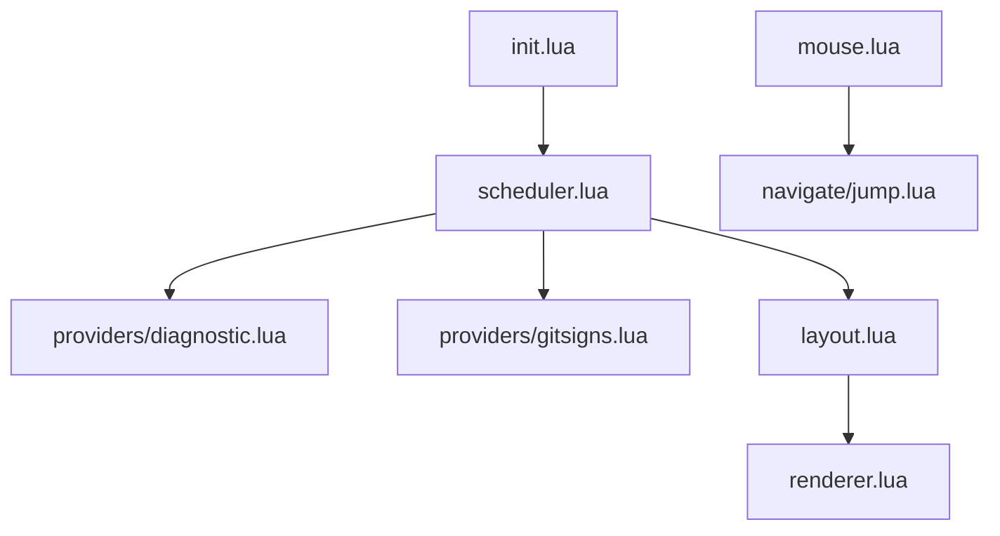

# petertriho/nvim-scrollbar

> Barre de défilement extensible pour Neovim, affichant curseur, diagnostics, git et recherche.

## Le problème
Dans Neovim, on ne voit pas où se trouvent erreurs, modifications git et résultats de recherche dans un long fichier.

## Ce que ça fait vraiment
Dessine une barre avec marques : curseur, diagnostics (COC et natif), ALE, git (gitsigns) et recherche (hlslens). On peut enregistrer des gestionnaires personnalisés qui renvoient des lignes à marquer. D'après le code : `init.lua` lit la config, `scheduler.lua` interroge les fournisseurs, `layout.lua` projette, `renderer.lua` dessine ; souris, minimap et `jump.lua` servent à naviguer.

## Comment c'est branché


## Essayer
```lua
use("petertriho/nvim-scrollbar")
require("scrollbar").setup()
```

## Coût et pièges
Gratuit. Le README annonce que la v2 (16 novembre 2026) change les options de `setup()` et exige Neovim 0.11 ; pour garder la v1, épingler la branche `v1` ou le tag `v1.0.0`. Le README mentionne encore Neovim 0.5.1 comme minimum.

## Ce que ce n'est pas
Pas un outil d'analyse de code : un habillage visuel de l'éditeur.

## Alternatives
Aucune alternative nommée dans le README.

## Pour toi
À surveiller seulement si tu codes sous Neovim : confort utile, mais la v2 casse la configuration.

