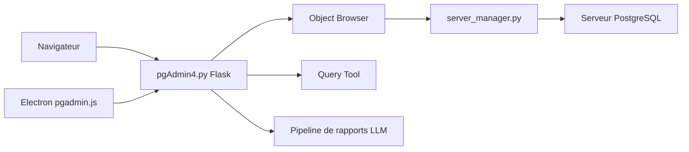

# pgadmin-org/pgadmin4

> PostgreSQL administration interface, as a web application or desktop app, for all database profiles.

## The problem
Exploring, querying and administering a PostgreSQL server from the command line alone is cumbersome for schemas and ad hoc queries.

## What it actually does
A Flask (Python) server and a React client. After authentication (MFA possible), you register servers, browse objects, run SQL in the query tool, and view dashboards. The source code also describes a file manager, cloud connectors (AWS) and an LLM report pipeline. An Electron runtime launches the Python server in desktop mode.

## How it is wired


## Trying it
```bash
corepack enable
cd $PGADMIN4_SRC
make install-node
make bundle
python3 -m venv venv
source venv/bin/activate
pip install -r $PGADMIN4_SRC/requirements.txt
python3 $PGADMIN4_SRC/web/pgAdmin4.py
```

## Cost and gotchas
The README mostly describes building from source: Node 20+, yarn, Python 3.9+, `pg_config` for psycopg3. A `config_local.py` sets server or desktop mode. Ready-to-use packages are not detailed here.

## What it is not
Not a data science or MLOps tool: it serves only PostgreSQL. The README is a development guide, not a user guide. The license is present but not recognized by GitHub: read it before redistributing.

## Alternatives
No alternative is cited in the README.

## For you
Adopt if you have PostgreSQL databases to inspect: an old project (2017), active, 370 open issues, license to re-read, otherwise irrelevant.
