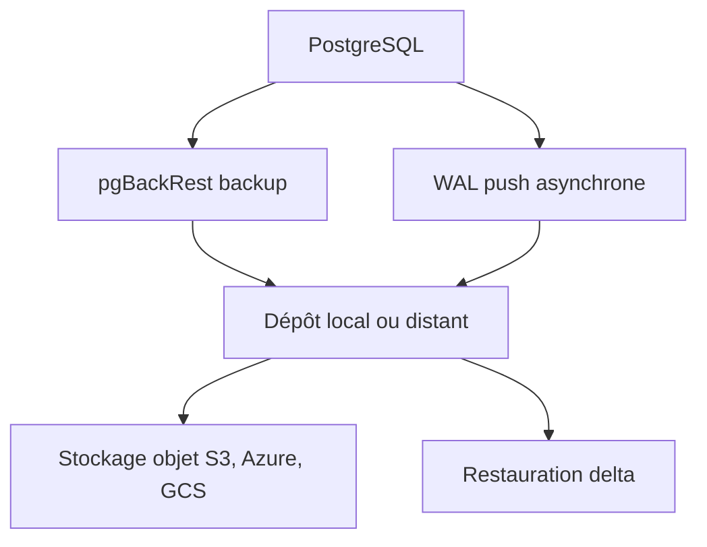

# pgbackrest/pgbackrest

> Parallel PostgreSQL backup and restore, for administrators of large databases.

## The problem
Home-grown PostgreSQL backups are slow, hard to verify and handle WAL archives poorly. A full restore of a multi-terabyte database takes hours.

## What it actually does
Full, differential and incremental backups (file-level or block-level), compressed on the fly (lz4, zstd) and processed in parallel. Handles asynchronous WAL archiving, backup from a standby, multiple repositories, encryption and delta restore. Every file has a checksum, re-verified at restore time.

## How it is wired
Simplified diagram based on the sheet, no diagram provided.

## Trying it
The README documents no commands: it points to the user guides, the command reference and the configuration reference on the project website.

## Cost and gotchas
Free. You need a repository (local disk, remote server over TLS/SSH, or object storage) and careful configuration, to be read in the per-operating-system guides.

## What it is not
Not a replication or high-availability tool: it backs up and restores. The README gives no command-line installation procedure.

## Alternatives
No alternative named in the README.

## For you
Adopt it if you run PostgreSQL in production: it is the reference for verifiable backups and fast restores, with the license to be checked before redistribution.
