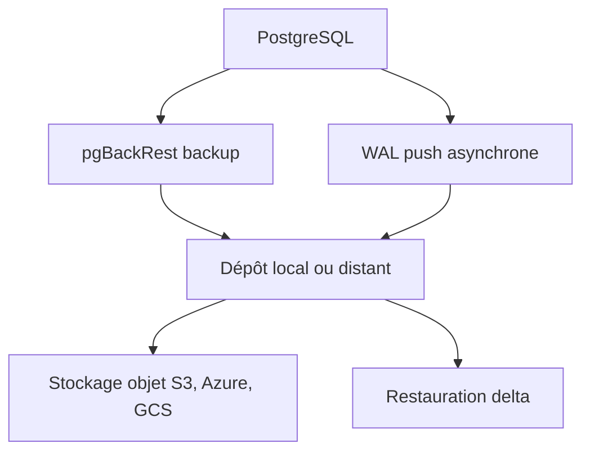

# pgbackrest/pgbackrest

> Sauvegarde et restauration PostgreSQL parallèle, pour les administrateurs de bases de grande taille.

## Le problème
Les sauvegardes PostgreSQL maison sont lentes, difficiles à vérifier et gèrent mal les archives WAL. Une restauration complète d'une base de plusieurs téraoctets prend des heures.

## Ce que ça fait vraiment
Sauvegardes complètes, différentielles et incrémentales (au niveau fichier ou bloc), compressées en flux (lz4, zstd) et traitées en parallèle. Gère l'archivage WAL asynchrone, la sauvegarde depuis un standby, plusieurs dépôts, le chiffrement et la restauration delta. Chaque fichier a une somme de contrôle, revérifiée à la restauration.

## Comment c'est branché
Schéma simplifié d'après la fiche, sans diagramme fourni.

## Essayer
Le README ne documente aucune commande : il renvoie aux guides utilisateur, à la référence des commandes et à la référence de configuration sur le site du projet.

## Coût et pièges
Gratuit. Il faut un dépôt (disque local, serveur distant en TLS/SSH ou stockage objet) et une configuration soignée, à lire dans les guides par système d'exploitation.

## Ce que ce n'est pas
Ce n'est pas un outil de réplication ni de haute disponibilité : il sauvegarde et restaure. Le README ne donne pas de procédure d'installation en ligne de commande.

## Alternatives
Aucune alternative nommée dans le README.

## Pour toi
Adopter si tu opères un PostgreSQL en production : c'est la référence pour des sauvegardes vérifiables et des restaurations rapides, la licence étant à contrôler avant redistribution.

