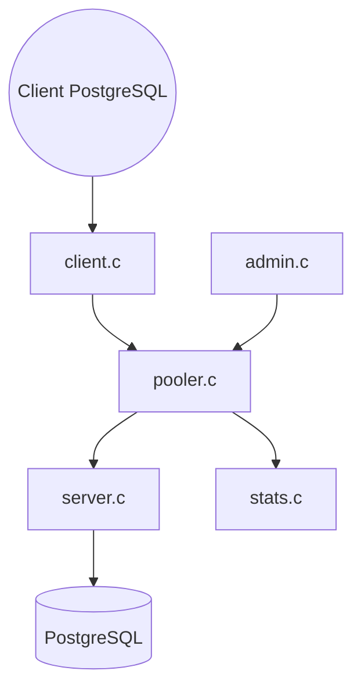

# pgbouncer/pgbouncer

> Lightweight PostgreSQL connection pooler, to limit the load from thousands of clients.

## The problem
Each PostgreSQL connection consumes a server process: a large number of clients exhausts the database.

## What it actually does
Sits between clients and PostgreSQL: it parses startup and authentication, picks a pool, reuses or opens a server connection and relays traffic. It resolves host names at each connection, handles TLS, an admin console, statistics, prepared statements and optional PAM, LDAP and systemd authentication.

## How it is wired


## Trying it
```bash
./configure --prefix=/usr/local
make
make install
meson setup build --prefix=/usr/local
meson compile -C build
meson install -C build
```

## Cost and gotchas
Free. Requires Libevent, pkg-config, OpenSSL and a C11 compiler. The Meson build is still experimental; Autoconf is recommended in production.

## What it is not
Not a high-availability or failover tool: it only does connection pooling. The README provides no ready-to-use binary.

## Alternatives
No alternative named in the README.

## For you
Adopt if your data stack relies on PostgreSQL and receives many connections: it is the standard component, to compile or install via package. Check the license.
