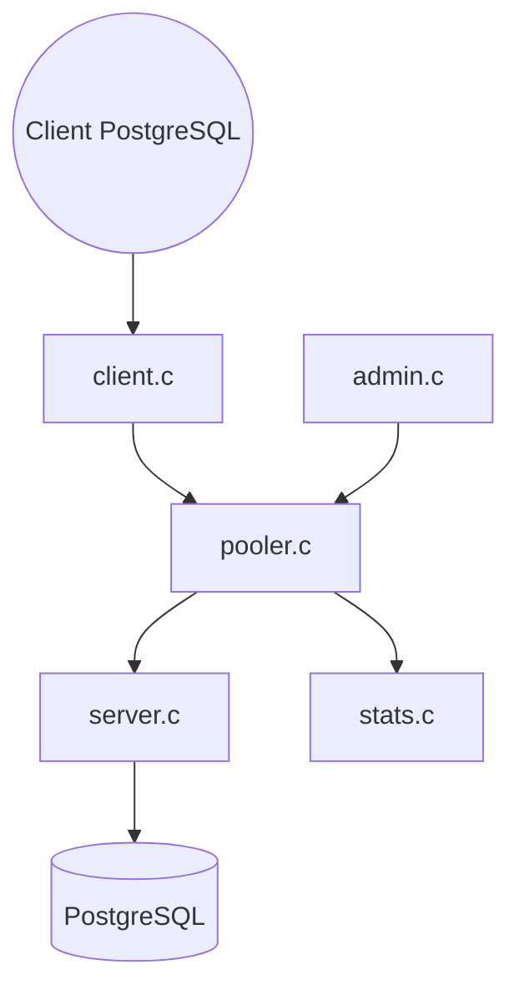

# pgbouncer/pgbouncer

> Concentrateur léger de connexions PostgreSQL, pour limiter la charge de milliers de clients.

## Le problème
Chaque connexion PostgreSQL consomme un processus serveur : un grand nombre de clients épuise la base.

## Ce que ça fait vraiment
Se place entre les clients et PostgreSQL : il analyse le démarrage et l'authentification, choisit un pool, réutilise ou ouvre une connexion serveur et relaie le trafic. Il résout les noms d'hôte à chaque connexion, gère TLS, une console d'administration, des statistiques, les requêtes préparées et les authentifications PAM, LDAP et systemd en option.

## Comment c'est branché


## Essayer
```bash
./configure --prefix=/usr/local
make
make install
meson setup build --prefix=/usr/local
meson compile -C build
meson install -C build
```

## Coût et pièges
Gratuit. Il faut Libevent, pkg-config, OpenSSL et un compilateur C11. Le build Meson est encore expérimental ; Autoconf est recommandé en production.

## Ce que ce n'est pas
Ce n'est pas un outil de haute disponibilité ni de bascule : il ne fait que le regroupement de connexions. Le README ne donne pas de binaire prêt à l'emploi.

## Alternatives
Aucune alternative nommée dans le README.

## Pour toi
Adopter si ta pile de données repose sur PostgreSQL et reçoit beaucoup de connexions : c'est le composant standard, à compiler ou installer par paquet. Licence à contrôler.

