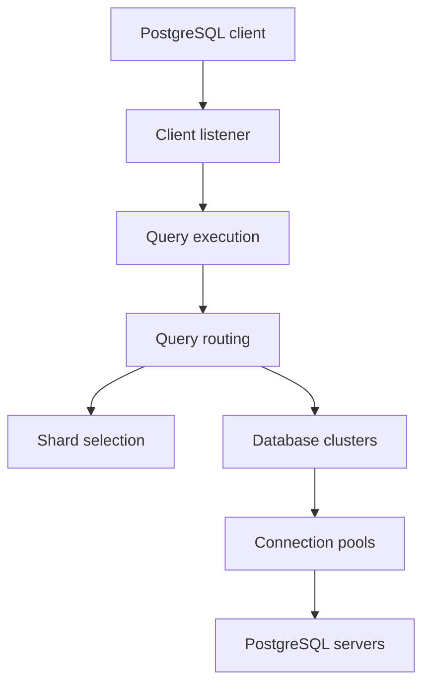

# pgdogdev/pgdog

> PostgreSQL proxy in Rust: connection pooling, load balancing and sharding of whole databases.

## The problem
Postgres hits limits on connections and write scaling; spreading reads and data across several servers forces you to modify the application.

## What it actually does
Sits between clients and Postgres. Connection pooling per transaction or session, balancing across replicas with health checks, read/write splitting by query analysis, failover after a replica promotion. Sharding by partition functions or by schema, cross-shard queries, distributed `COPY`, two-phase commit, re-sharding via logical replication. RDS IAM, Azure and Vault authentication.

## How it is wired


## Trying it
```bash
helm repo add pgdogdev https://helm.pgdog.dev
helm install pgdog pgdogdev/pgdog
docker-compose up
PGPASSWORD=postgres psql -h 127.0.0.1 -p 6432 -U postgres
```

## Cost and gotchas
Free; two configuration files (`pgdog.toml`, `users.toml`). Limited SQL support across shards (subqueries and CTEs not supported). An enterprise edition exists for organizations that reject the AGPL.

## What it is not
Not a failover orchestrator: it complements Patroni or RDS without replacing them. The admin database is not fully PgBouncer-compatible.

## Alternatives
PgBouncer is cited as a point of comparison for pooling.

## For you
Worth watching: relevant if your MLOps pipelines saturate Postgres connections, with an AGPL license to validate.
