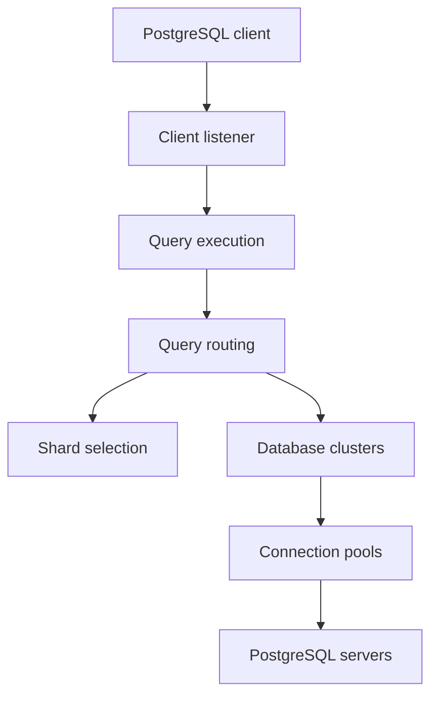

# pgdogdev/pgdog

> Proxy PostgreSQL en Rust : pool de connexions, répartition de charge et sharding de bases entières.

## Le problème
Postgres plafonne en connexions et en échelle d'écriture ; répartir lectures et données sur plusieurs serveurs oblige à modifier l'application.

## Ce que ça fait vraiment
Se place entre les clients et Postgres. Pool de connexions par transaction ou session, équilibrage entre réplicas avec contrôles de santé, séparation lectures et écritures par analyse des requêtes, bascule suite à une promotion de réplica. Sharding par fonctions de partition ou par schéma, requêtes inter-shards, `COPY` réparti, commit en deux phases, re-sharding par réplication logique. Authentification RDS IAM, Azure et Vault.

## Comment c'est branché


## Essayer
```bash
helm repo add pgdogdev https://helm.pgdog.dev
helm install pgdog pgdogdev/pgdog
docker-compose up
PGPASSWORD=postgres psql -h 127.0.0.1 -p 6432 -U postgres
```

## Coût et pièges
Gratuit ; deux fichiers de configuration (`pgdog.toml`, `users.toml`). Support SQL limité en inter-shards (sous-requêtes et CTE non supportées). Une édition entreprise existe pour les organisations qui refusent l'AGPL.

## Ce que ce n'est pas
Pas un orchestrateur de bascule : il complète Patroni ou RDS sans les remplacer. La base d'administration n'est pas totalement compatible PgBouncer.

## Alternatives
PgBouncer est cité comme point de comparaison pour le pooling.

## Pour toi
À surveiller : pertinent si tes pipelines MLOps saturent Postgres en connexions, avec une licence AGPL à valider.

