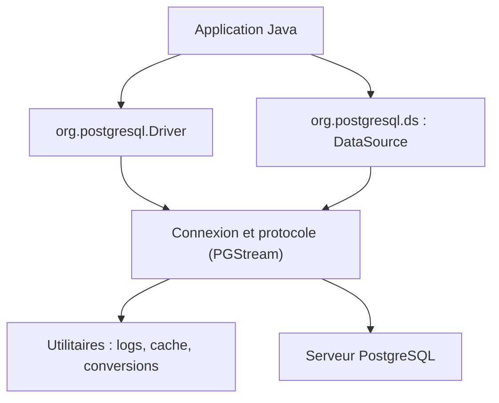

# pgjdbc/pgjdbc

> Official pure-Java JDBC driver that connects Java applications to PostgreSQL.

## The problem
A Java application needs a driver that speaks PostgreSQL's network protocol behind the standard JDBC interfaces.

## What it actually does
The driver implements java.sql.Driver and the DataSource classes (simple, pooled, XA) in pure Java (Type 4) and talks the native protocol. It handles SSL and authentication, server-side prepared statements after a threshold, binary transfer, batched INSERT rewriting, failover between primary and secondary servers, and load balancing. The README mostly documents the connection URL and a long table of properties (timeouts, buffers, SSL, sslmode).

## How it is wired


## Trying it
```bash
# Dépendance Maven : org.postgresql:postgresql
# URL de connexion documentée :
# jdbc:postgresql://host:port/database?property1=value1
```

## Cost and gotchas
Free. The FINEST log level can expose queries, parameters and connection details. logServerErrorDetail is true by default: server errors, including SQL and values, end up in exceptions and logs.

## What it is not
It is not an ORM or a full connection pool, and it only works with PostgreSQL. Most people do not need to compile it.

## Alternatives
No alternative mentioned in the README.

## For you
Adopt it as soon as a Java service talks to PostgreSQL: it is the reference driver, to be configured carefully for logs and timeouts.
