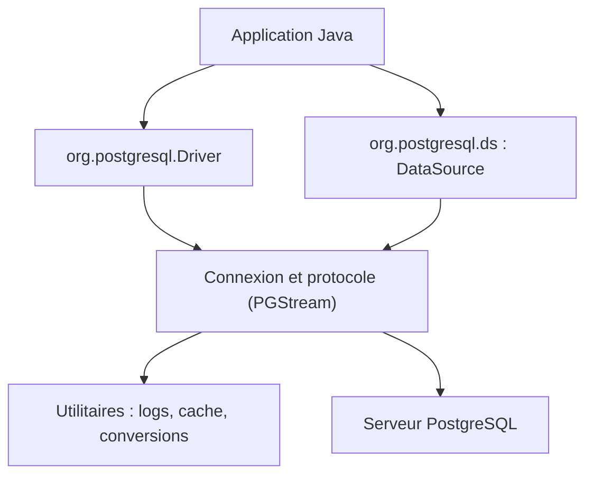

# pgjdbc/pgjdbc

> Pilote JDBC officiel en Java pur qui connecte les applications Java à PostgreSQL.

## Le problème
Une application Java a besoin d'un pilote qui parle le protocole réseau de PostgreSQL derrière les interfaces JDBC standard.

## Ce que ça fait vraiment
Le pilote implémente java.sql.Driver et les DataSource (simple, pool, XA) en Java pur (Type 4) et dialogue en protocole natif. Il gère SSL et authentification, requêtes préparées côté serveur après un seuil, transfert binaire, réécriture des INSERT par lots, bascule entre serveurs primaire et secondaire et répartition de charge. Le README documente surtout l'URL de connexion et un long tableau de propriétés (timeouts, tampons, SSL, sslmode).

## Comment c'est branché


## Essayer
```bash
# Dépendance Maven : org.postgresql:postgresql
# URL de connexion documentée :
# jdbc:postgresql://host:port/database?property1=value1
```

## Coût et pièges
Gratuit. Le niveau de log FINEST peut exposer requêtes, paramètres et détails de connexion. logServerErrorDetail est vrai par défaut : les erreurs serveur, avec SQL et valeurs, passent dans les exceptions et les logs.

## Ce que ce n'est pas
Ce n'est pas un ORM ni un pool de connexions complet, et il ne sert qu'à PostgreSQL. La plupart des gens n'ont pas à le compiler.

## Alternatives
Aucune alternative citée dans le README.

## Pour toi
À adopter dès qu'un service Java parle à PostgreSQL : c'est le pilote de référence, à configurer avec soin pour les logs et les timeouts.

