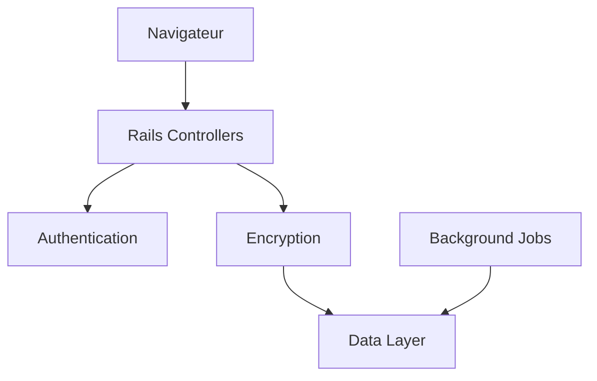

# pglombardo/PasswordPusher

> Rails web application for sharing passwords, notes, files and URLs through self-destructing links.

## The problem
Sending a secret by chat or email leaves it lying around in many histories.

## What it actually does
You drop a secret; the recipient gets a link that expires after a number of views and/or a delay, with an optional passphrase. Encrypted storage, deletion on expiry, audit log, TOTP MFA, admin dashboard, JSON API v2, official CLI and Chrome extension, 31 languages. Encryption via lockbox according to the diagram.

## How it is wired


## Trying it
```bash
docker compose up -d
curl -s https://YOUR_HOST/api/v2/version
```

## Cost and gotchas
Free when self-hosted; DNS and TLS are on you (`TLS_DOMAIN`). One-click deployments (Heroku, DigitalOcean…) are billed by the host. Some "Pro" features are not in the OSS version.

## What it is not
Not a password manager: links are ephemeral. The service is operated by Apnotic, LLC; donations are temporarily disabled.

## Alternatives
- onetimesecret/onetimesecret: same principle, Ruby + Redis stack.

## For you
Worth watching: useful for sharing API keys or access with a data team, but outside the core AI domain.
