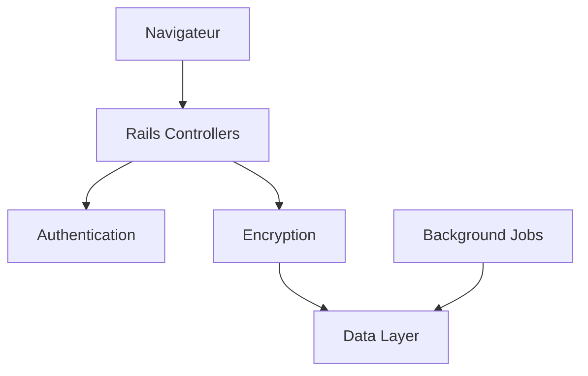

# pglombardo/PasswordPusher

> Application web Rails pour partager mots de passe, notes, fichiers et URL via des liens auto-détruits.

## Le problème
Envoyer un secret par chat ou email le laisse traîner dans de nombreux historiques.

## Ce que ça fait vraiment
Tu déposes un secret ; le destinataire reçoit un lien qui expire après un nombre de vues et/ou un délai, avec phrase secrète optionnelle. Stockage chiffré, suppression à expiration, journal d'audit, MFA TOTP, tableau de bord admin, API JSON v2, CLI et extension Chrome officiels, 31 langues. Chiffrement via lockbox d'après le diagramme.

## Comment c'est branché


## Essayer
```bash
docker compose up -d
curl -s https://YOUR_HOST/api/v2/version
```

## Coût et pièges
Gratuit en auto-hébergement ; DNS et TLS à ta charge (`TLS_DOMAIN`). Les déploiements en un clic (Heroku, DigitalOcean…) sont facturés par l'hébergeur. Certaines fonctions « Pro » ne sont pas dans la version OSS.

## Ce que ce n'est pas
Pas un gestionnaire de mots de passe : les liens sont éphémères. Le service est opéré par Apnotic, LLC ; le don est temporairement désactivé.

## Alternatives
- onetimesecret/onetimesecret : même principe, pile Ruby + Redis.

## Pour toi
À surveiller : utile pour partager des clés d'API ou accès à une équipe data, mais hors cœur de métier IA.

