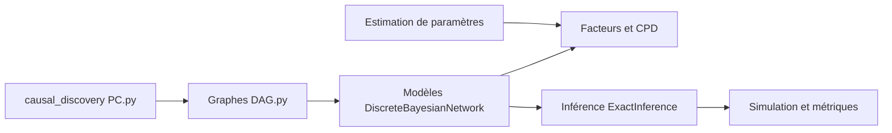

# pgmpy/pgmpy

> Python library for causal and probabilistic graphical models, scikit-learn compatible, for data scientists.

## The problem
Doing causal discovery, Bayesian inference or simulation means assembling graph structures, estimators and algorithms scattered across different places.

## What it actually does
It provides structures (DAG, PDAG, ADMG, discrete, linear Gaussian, functional and dynamic Bayesian networks, structural equation models), structure learning (PC, HillClimb) with independence tests and scores, parameter estimation, exact, approximate and causal inference, adjustment identification, simulation and validation. The Torch/Pyro backend serves functional models; the BIF and XDSL formats are read and written.

## How it is wired


## Trying it
```bash
pip install pgmpy
conda install conda-forge::pgmpy
```
```python
from pgmpy.example_models import load_model
from pgmpy.estimators import PC
alarm_df = load_model("bnlearn/alarm").simulate(n_samples=100)
dag = PC(data=alarm_df).estimate(ci_test="chi_square", return_type="dag")
```

## Cost and gotchas
Free, on CPU. The Torch and Pyro backend has to be installed for functional models. 640 open issues: a lot of debt. The code contains two structure discovery APIs (`causal_discovery` and older estimators).

## What it is not
Not a deep learning framework nor a dashboard tool. Causal discovery results depend on strong assumptions (independence tests, sample size).

## Alternatives
No alternative is cited in the README.

## For you
Adopt if you do causal inference or Bayesian networks: MIT, active since 2013, pushed in September 2026, sklearn-compatible API.
