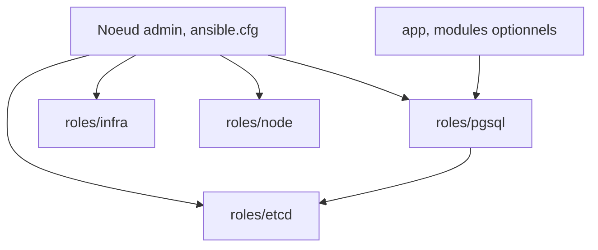

# pgsty/pigsty

> Self-hosted PostgreSQL distribution with high availability, PITR backup, monitoring and 575 extensions.

## The problem
Running a production PostgreSQL (replication, backups, pooling, metrics) without a managed service amounts to assembling a dozen tools.

## What it actually does
Ansible playbooks that deploy Patroni and etcd (high availability), pgBackRest (PITR), pgBouncer and HAProxy (access), plus a Victoria and Grafana stack for monitoring. A pigsty.yml file describes clusters, databases and users. Optional modules: Redis, MinIO, Docker, Supabase, and several alternative PostgreSQL kernels.

## How it is wired


## Trying it
```bash
curl -fsSL https://repo.pigsty.io/get | bash; cd ~/pigsty;
./configure -g
./deploy.yml
```

## Cost and gotchas
Free, but you need a Linux x86_64 or aarch64 node with an admin user (ssh and passwordless sudo). The install script is run from a remote URL. More than 300 parameters to master.

## What it is not
Not just a Postgres: it is an operations platform that installs on your machines. The RPO and RTO figures are the README's, not verified here. README truncated in the card.

## Alternatives
No alternative named in the README (the cost of an RDS service is the target).

## For you
Worth watching: serious for self-hosting a PostgreSQL for your data and MLOps metadata, but heavy to operate for a small need.
