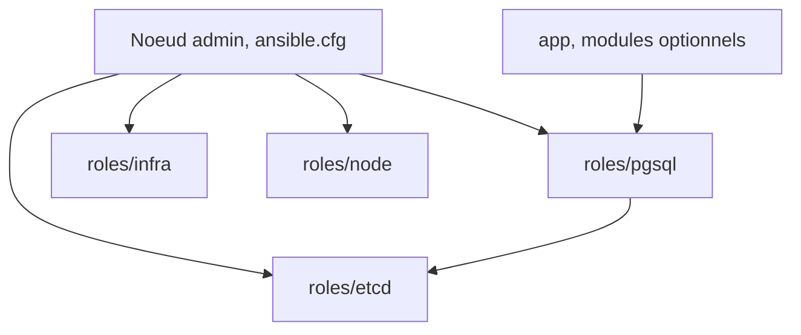

# pgsty/pigsty

> Distribution PostgreSQL auto-hébergée avec haute disponibilité, sauvegarde PITR, supervision et 575 extensions.

## Le problème
Opérer un PostgreSQL de production (réplication, sauvegardes, pooling, métriques) sans service géré revient à assembler une dizaine d'outils.

## Ce que ça fait vraiment
Playbooks Ansible qui déploient Patroni et etcd (haute disponibilité), pgBackRest (PITR), pgBouncer et HAProxy (accès), plus une pile Victoria et Grafana pour la supervision. Un fichier pigsty.yml décrit clusters, bases et utilisateurs. Modules optionnels : Redis, MinIO, Docker, Supabase, et plusieurs noyaux PostgreSQL alternatifs.

## Comment c'est branché


## Essayer
```bash
curl -fsSL https://repo.pigsty.io/get | bash; cd ~/pigsty;
./configure -g
./deploy.yml
```

## Coût et pièges
Gratuit, mais il faut un noeud Linux x86_64 ou aarch64 avec un utilisateur admin (ssh et sudo sans mot de passe). Le script d'installation est lancé depuis une URL distante. Plus de 300 paramètres à maîtriser.

## Ce que ce n'est pas
Pas un simple Postgres : c'est une plateforme d'exploitation qui s'installe sur tes machines. Les chiffres RPO et RTO sont ceux du README, non vérifiés ici. README tronqué dans la fiche.

## Alternatives
Aucune alternative nommée dans le README (le coût d'un service RDS est visé).

## Pour toi
À surveiller : sérieux pour héberger toi-même un PostgreSQL pour tes données et métadonnées MLOps, mais lourd à exploiter pour un petit besoin.

