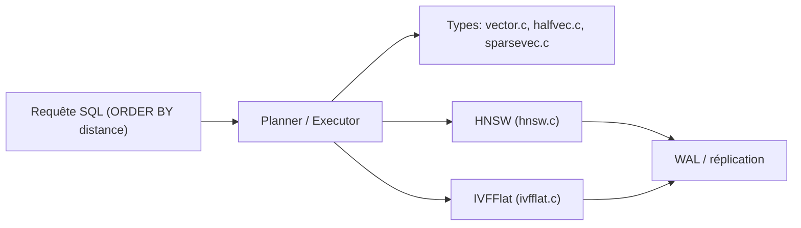

# pgvector/pgvector

> Postgres extension for vector similarity search, to store embeddings alongside the rest of your data.

## The problem
Adding a separate vector database complicates the architecture and loses Postgres joins and transactions.

## What it actually does
Adds the `vector`, `halfvec`, `bit` and `sparsevec` types, the L2, inner product, cosine, L1, Hamming and Jaccard distances, exact or approximate search with HNSW and IVFFlat indexes, iterative scans with filtering, binary quantization. Inherits Postgres's ACID, point-in-time recovery and replication.

## How it is wired


## Trying it
```bash
cd /tmp
git clone --branch v0.8.7 https://github.com/pgvector/pgvector.git
cd pgvector
make
make install # may need sudo
```
```sql
CREATE EXTENSION vector;
CREATE TABLE items (id bigserial PRIMARY KEY, embedding vector(3));
SELECT * FROM items ORDER BY embedding <-> '[3,1,2]' LIMIT 5;
```

## Cost and gotchas
Free; Postgres 13+. HNSW indexes consume memory (`maintenance_work_mem`); filtering is applied after the index unless using iterative scans. Compiled with `-march=native`: risk of "Illegal instruction" on another machine. License not identified by GitHub.

## What it is not
Not an engine dedicated to billions of vectors: beyond that, quantization, partitioning or sharding (Citus, PgDog).

## Alternatives
No alternative named in the README.

## For you
Adopt for RAG or semantic search if you already have Postgres: simple, built into hosting providers; check the license.
