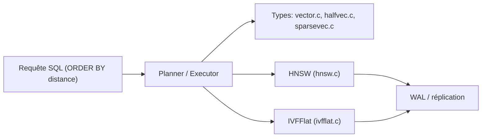

# pgvector/pgvector

> Extension Postgres de recherche de similarité vectorielle, pour stocker les embeddings avec le reste des données.

## Le problème
Ajouter une base vectorielle séparée complique l'architecture et fait perdre les jointures et transactions de Postgres.

## Ce que ça fait vraiment
Ajoute les types `vector`, `halfvec`, `bit` et `sparsevec`, les distances L2, produit scalaire, cosinus, L1, Hamming et Jaccard, la recherche exacte ou approchée avec index HNSW et IVFFlat, les scans itératifs avec filtre, la quantification binaire. Hérite d'ACID, de la restauration à un instant donné et de la réplication de Postgres.

## Comment c'est branché


## Essayer
```bash
cd /tmp
git clone --branch v0.8.7 https://github.com/pgvector/pgvector.git
cd pgvector
make
make install # may need sudo
```
```sql
CREATE EXTENSION vector;
CREATE TABLE items (id bigserial PRIMARY KEY, embedding vector(3));
SELECT * FROM items ORDER BY embedding <-> '[3,1,2]' LIMIT 5;
```

## Coût et pièges
Gratuit ; Postgres 13+. Les index HNSW consomment de la mémoire (`maintenance_work_mem`) ; filtrage appliqué après l'index sauf scans itératifs. Compilation avec `-march=native` : risque d'« Illegal instruction » sur une autre machine. Licence non identifiée par GitHub.

## Ce que ce n'est pas
Pas un moteur dédié à des milliards de vecteurs : au-delà, quantification, partitionnement ou sharding (Citus, PgDog).

## Alternatives
Aucune alternative nommée dans le README.

## Pour toi
À adopter pour du RAG ou de la recherche sémantique si tu as déjà Postgres : simple, intégré aux hébergeurs ; vérifie la licence.

