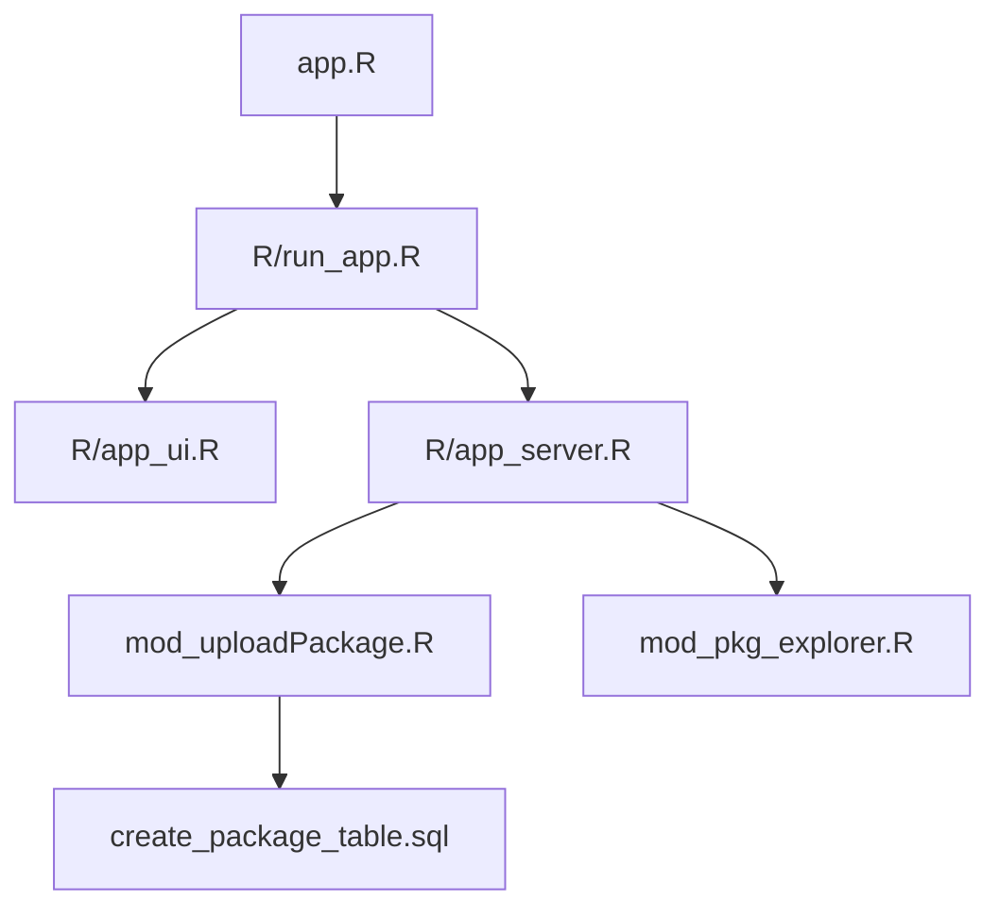

# pharmaR/riskassessment

> Shiny application that assesses the risk of using an R package, for teams in regulated sectors.

## The problem
Validating R packages in pharma requires reading code metrics without a shared review tool.

## What it actually does
Adds a Shiny interface to `riskmetric`: metric analysis without coding, comments, risk category (low, medium, high), downloadable reports, a database, authentication with roles and editable metric weights. Assessments are stored in SQLite.

## How it is wired


## Trying it
```bash
# commandes R du README :
# renv::activate()
# renv::restore()
# puis exécuter app.R
```

## Cost and gotchas
Free. Clone the repository and use `renv.lock` rather than `install_github`. Initial admin password `QWERTY1` must be changed. Demo without persistent storage; last push in February 2025.

## What it is not
Not a complete regulatory validation: the README says it helps the decision, not that it replaces it.

## Alternatives
No alternative named in the README.

## For you
Watch: useful if you validate R packages in a regulated environment, but the repository is barely active and the license needs clarifying.
