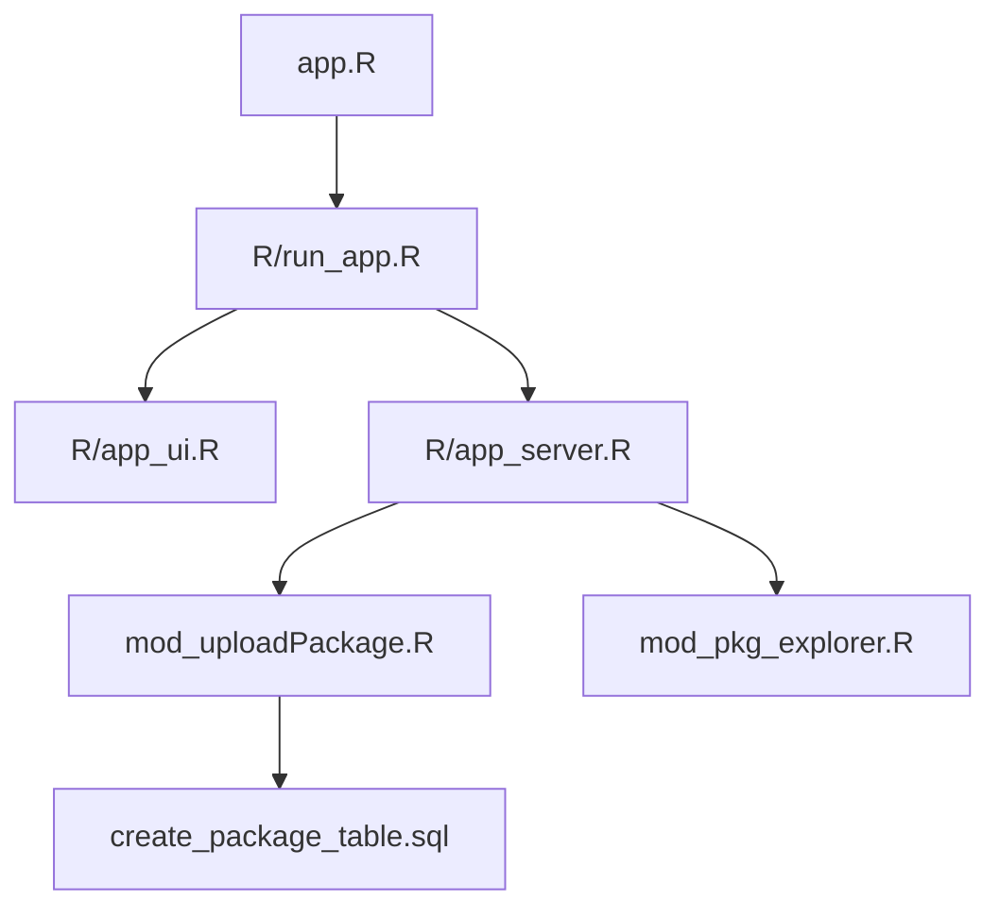

# pharmaR/riskassessment

> Application Shiny qui évalue le risque d'utiliser un paquet R, pour équipes en secteur régulé.

## Le problème
Valider des paquets R en pharmacie demande de lire des métriques de code sans outil de revue partagé.

## Ce que ça fait vraiment
Ajoute à `riskmetric` une interface Shiny : analyse des métriques sans coder, commentaires, catégorie de risque (faible, moyen, élevé), rapports téléchargeables, base de données, authentification avec rôles et poids de métriques modifiables. Les évaluations sont stockées dans SQLite.

## Comment c'est branché


## Essayer
```bash
# commandes R du README :
# renv::activate()
# renv::restore()
# puis exécuter app.R
```

## Coût et pièges
Gratuit. Cloner le dépôt et utiliser `renv.lock` plutôt que `install_github`. Mot de passe admin initial `QWERTY1` à changer. Démo sans stockage persistant ; dernier push en février 2025.

## Ce que ce n'est pas
Pas une validation réglementaire complète : le README dit qu'elle aide la décision, pas qu'elle la remplace.

## Alternatives
Aucune alternative nommée dans le README.

## Pour toi
Surveiller : utile si tu valides des paquets R en milieu régulé, mais dépôt peu actif et licence à clarifier.

