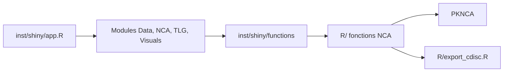

# pharmaverse/aNCA

> R Shiny application for non-compartmental pharmacokinetic analysis, for clinical and preclinical trial scientists.

## The problem
Computing pharmacokinetic parameters (AUC, half-life) by hand or with disparate scripts is slow and hard to reproduce.

## What it actually does
Loads a dataset, applies filters, runs the NCA analysis via the PKNCA package, sets the half-life by rules or manually, defines AUC intervals. Produces boxplots, tables, PP and ADPP (CDISC) datasets, saves the settings and generates a reproducible R script.

## How it is wired


## Trying it
```bash
# Dans une console R
install.packages("aNCA")
# ou
pak::pak("pharmaverse/aNCA")
# puis
aNCA::run_app()
```

## Cost and gotchas
Free. R is required. The repository has 225 open issues.

## What it is not
Not a general-purpose statistics tool: it is dedicated to NCA in pharmacokinetics, and depends on PKNCA for the calculations.

## Alternatives
PKNCA, the package that does the calculations (named in the README).

## For you
Worth watching: relevant only if you work with pharma/clinical data, otherwise off topic.
