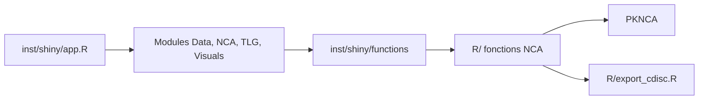

# pharmaverse/aNCA

> Application R Shiny d'analyse pharmacocinétique non compartimentale, pour scientifiques en essais cliniques et précliniques.

## Le problème
Calculer des paramètres pharmacocinétiques (AUC, demi-vie) à la main ou par scripts disparates est lent et peu reproductible.

## Ce que ça fait vraiment
Charge un jeu de données, applique des filtres, lance l'analyse NCA via le paquet PKNCA, règle la demi-vie par règles ou à la main, définit des intervalles d'AUC. Produit boxplots, tableaux, jeux PP et ADPP (CDISC), sauvegarde les réglages et génère un script R reproductible.

## Comment c'est branché


## Essayer
```bash
# Dans une console R
install.packages("aNCA")
# ou
pak::pak("pharmaverse/aNCA")
# puis
aNCA::run_app()
```

## Coût et pièges
Gratuit. Il faut R. Le dépôt compte 225 issues ouvertes.

## Ce que ce n'est pas
Pas un outil généraliste de statistiques : il est dédié à l'NCA en pharmacocinétique, et dépend de PKNCA pour les calculs.

## Alternatives
PKNCA, le paquet qui fait les calculs (nommé dans le README).

## Pour toi
À surveiller : pertinent seulement si tu travailles en données pharma/cliniques, sinon hors sujet.

