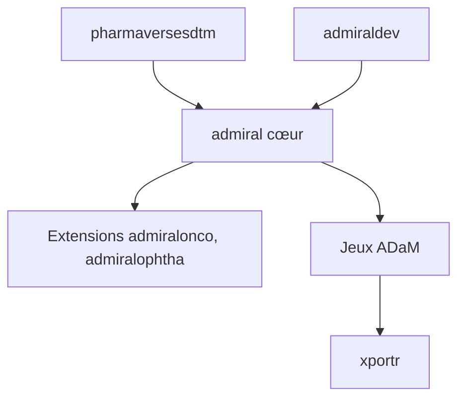

# pharmaverse/admiral

> Open-source R toolbox to build ADaM datasets in clinical research.

## The problem
Every lab rewrites its own ADaM derivations for clinical trials, with no common approach.

## What it actually does
Modular, tested functions to derive ADSL, BDS and OCCDS from SDTM data, with vignettes and example scripts. A family of packages complements the core: extensions by therapeutic area (`admiralonco`, `admiralophtha`…) and by company. Releases follow a six-month rhythm.

## How it is wired
Simplified diagram based on the sheet, no diagram provided.



## Trying it
```r
install.packages("admiral")
pak::pkg_install("pharmaverse/admiral", dependencies = TRUE)
```

## Cost and gotchas
R and the `pharmaversesdtm` package (prerequisite); knowledge of the CDISC ADaM standard is required. Nothing paid.

## What it is not
Not a "one line and ADaM appears" solution: the README refuses to automate ADaM. It will never cover all the derivations of a study.

## Alternatives
No alternative named in the README.

## For you
Ignore: specific to clinical programming in R, unless you work on pharmaceutical trial data.
