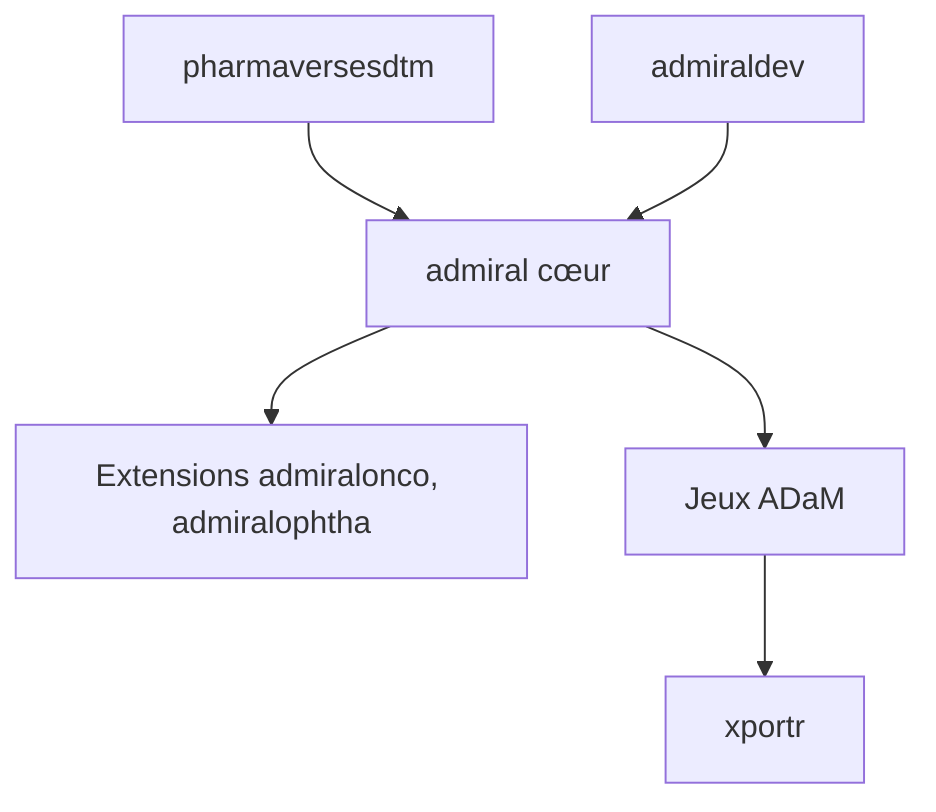

# pharmaverse/admiral

> Boîte à outils R open source pour construire des jeux de données ADaM en recherche clinique.

## Le problème
Chaque laboratoire réécrit ses propres dérivations ADaM pour les essais cliniques, sans approche commune.

## Ce que ça fait vraiment
Fonctions modulaires et testées pour dériver ADSL, BDS et OCCDS à partir de données SDTM, avec vignettes et scripts d'exemple. Une famille de paquets complète le cœur : extensions par domaine thérapeutique (`admiralonco`, `admiralophtha`…) et par société. Les versions suivent un rythme de six mois.

## Comment c'est branché
Schéma simplifié d'après la fiche, sans diagramme fourni.



## Essayer
```r
install.packages("admiral")
pak::pkg_install("pharmaverse/admiral", dependencies = TRUE)
```

## Coût et pièges
R et le paquet `pharmaversesdtm` (prérequis) ; la connaissance du standard CDISC ADaM est nécessaire. Rien de payant.

## Ce que ce n'est pas
Pas une solution « une ligne et l'ADaM apparaît » : le README refuse d'automatiser ADaM. Il ne couvrira jamais toutes les dérivations d'une étude.

## Alternatives
Aucune alternative nommée dans le README.

## Pour toi
Ignorer : spécifique à la programmation clinique en R, sauf si tu travailles sur des données d'essais pharmaceutiques.

