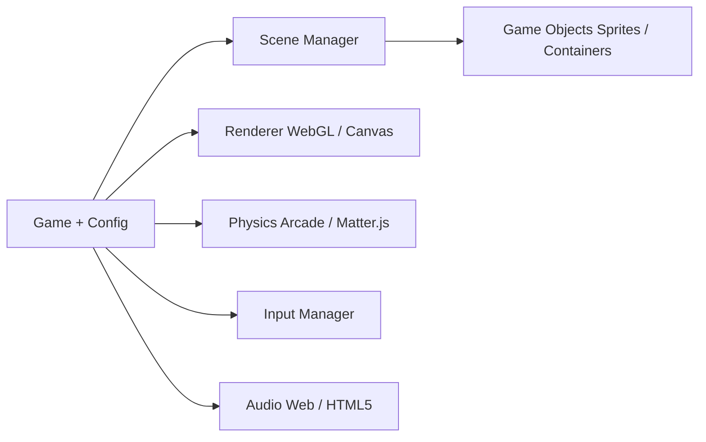

# phaserjs/phaser

> HTML5 game framework with WebGL and Canvas rendering for desktop and mobile browsers.

## The problem
Building a web game means assembling rendering, physics, input, sound and asset loading.

## What it actually does
Phaser provides a scene-based architecture, an asset loader, two physics engines (Arcade and Matter.js), animations, cameras, tilemaps, particles and tweens. Version 4 replaces the rendering with a WebGL node architecture, a unified filter system and GPU layers for millions of sprites or tiles. The repository ships "AI agent skills" and TypeScript definitions. Developed by Phaser Studio Inc.

## How it is wired


## Trying it
```bash
npm install phaser
npm create @phaserjs/game@latest
```

## Cost and gotchas
Free (MIT). The unminified `phaser.js` file exceeds 8 MB because of the built-in documentation; the minified version is 345 KB compressed. Version 4 breaks several things from Phaser 3 (migration guide provided).

## What it is not
Neither a full 3D engine nor a data visualization tool: it is a 2D game engine.

## Alternatives
- No alternative named in the README.

## For you
Ignore: a 2D game engine is outside a data/AI/MLOps workflow.
