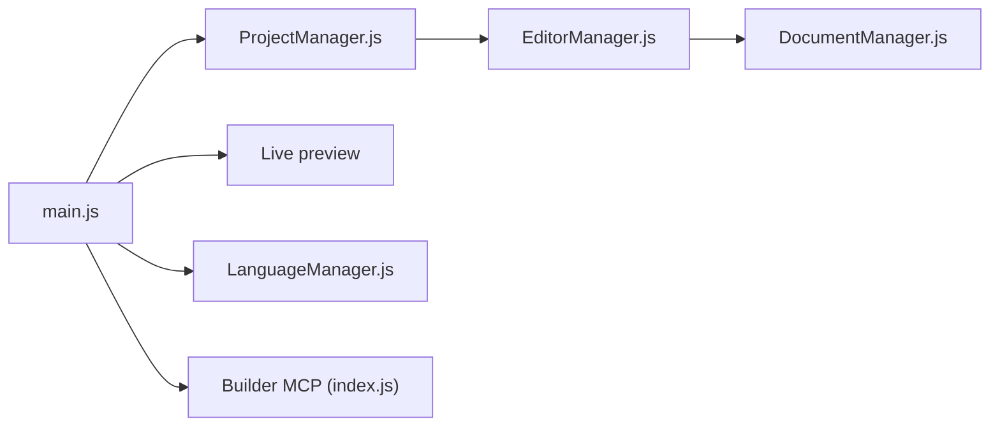

# phcode-dev/phoenix

> Free code editor running in the browser, focused on web development.

## The problem
Web editors are often heavy; Phoenix aims for a lightweight editor, compatible with Brackets extensions.

## What it actually does
Project editing, live preview, JavaScript language services, Git integration, extensions, remote files and an MCP "Builder" service to drive a dev build from Claude Code or Codex. The core can run from a static web server, with no build step for development.

## How it is wired


## Trying it
```bash
npm install
npm run build
npm run serve
```
Then open http://localhost:8000/src in Chrome or Edge.

## Cost and gotchas
Free. Global gulp-cli required to build. Chrome or Edge recommended. 261 open issues.

## What it is not
Not a full IDE for Python or notebooks; brackets-node extensions are not compatible.

## Alternatives
Brackets (whose extensions it reuses).

## For you
General-purpose web editor with no benefit for data/AI: ignore. Note the AGPL.
