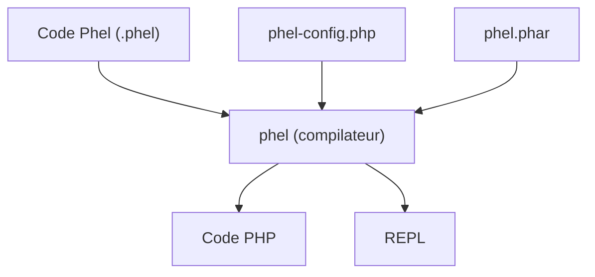

# phel-lang/phel-lang

> Lisp compiled to PHP, with macros, persistent data structures and a REPL, for PHP developers.

## The problem
PHP offers neither advanced functional style, nor macros, nor immutable data structures.

## What it actually does
A Lisp-family language inspired by Clojure: REPL, execution, tests, compilation to PHP, online evaluation, interoperability with PHP classes, standalone PHAR. Also installs skill files for coding agents.

## How it is wired
Simplified diagram based on the sheet, no diagram provided.


## Trying it
```bash
composer require phel-lang/phel-lang
./vendor/bin/phel repl
./vendor/bin/phel init
./vendor/bin/phel run src/main.phel
```

## Cost and gotchas
The package manager is Composer, not pip: the deployment field is approximate. PHP 8.5 or later; Windows is partial effort. PHP is not in the list of prerequisites.

## What it is not
Not a standalone language: it runs on PHP. Not oriented toward data or AI.

## Alternatives
None named in the README.

## For you
Ignore: a curiosity for PHP developers, unrelated to your data / AI field.
