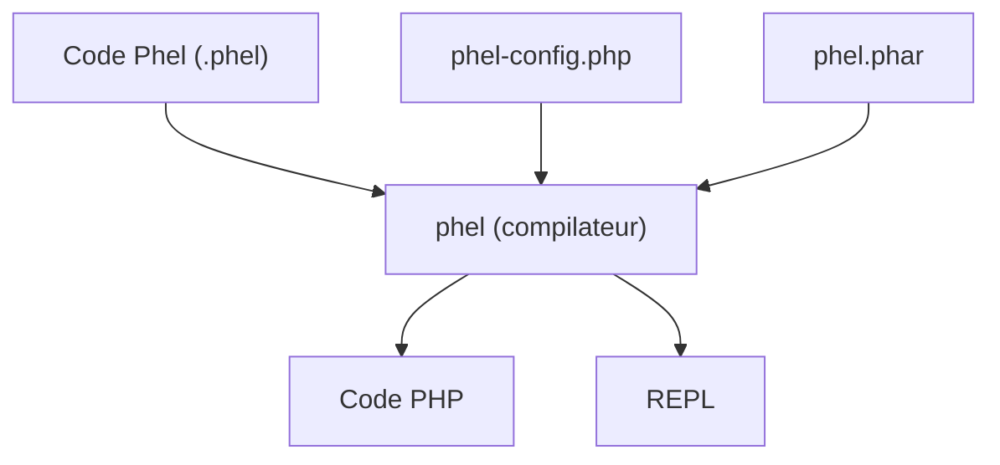

# phel-lang/phel-lang

> Lisp compilé vers PHP, avec macros, structures persistantes et REPL, pour développeurs PHP.

## Le problème
PHP n'offre ni style fonctionnel poussé, ni macros, ni structures de données immuables.

## Ce que ça fait vraiment
Langage de la famille Lisp inspiré de Clojure : REPL, exécution, tests, compilation en PHP, évaluation en ligne, interopérabilité avec les classes PHP, PHAR autonome. Installe aussi des fichiers de compétences pour des agents de code.

## Comment c'est branché
Schéma simplifié d'après la fiche, sans diagramme fourni.


## Essayer
```bash
composer require phel-lang/phel-lang
./vendor/bin/phel repl
./vendor/bin/phel init
./vendor/bin/phel run src/main.phel
```

## Coût et pièges
Le gestionnaire est Composer, pas pip : le champ de déploiement est approximatif. PHP 8.5 ou plus ; Windows en effort partiel. PHP n'existe pas dans la liste des prérequis.

## Ce que ce n'est pas
Pas un langage autonome : il tourne sur PHP. Pas orienté data ni IA.

## Alternatives
Aucune nommée dans le README.

## Pour toi
À ignorer : curiosité pour développeurs PHP, sans lien avec ton métier data / IA.

