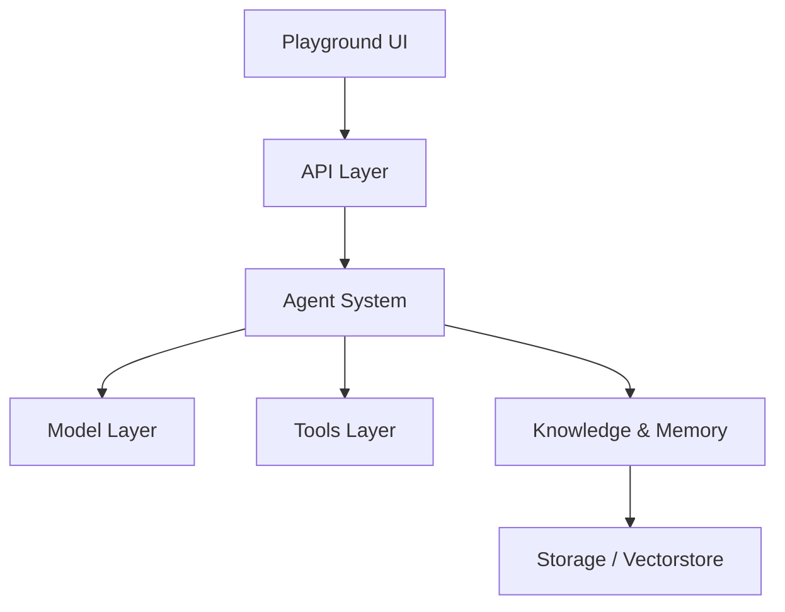

# phidatahq/phidata

> Agno (formerly phidata) framework for building agents, running them as a service and managing them through a web interface.

## The problem
Going from a demo agent to a platform with storage, API, permissions and traceability takes a lot of plumbing.

## What it actually does
Three building blocks: an SDK for writing agents, an AgentOS runtime (REST API with more than 50 endpoints, SSE and websockets, JWT/RBAC, multi-tenant) and a management UI. Sessions, memory and traces are stored in your own Postgres database. More than 100 integrations, cron scheduling, human approval. The repository points to separate deployment templates (Railway, Docker, AWS…).

## How it is wired


## Trying it
```text
Help me set up my agent platform.
Clone https://github.com/agno-agi/agentos-railway into a folder called agent-platform, cd in, read the README, and follow the get started guide.
```
(README prompt to hand to a coding agent.)

## Cost and gotchas
Model keys at your expense. Telemetry: one event per agent run, which can be disabled with `AGNO_TELEMETRY=false`. The provided diagram describes the old phidata.

## What it is not
Not just a library: the README targets a full platform. No explicit pip command in the excerpt.

## Alternatives
- No alternative named in the README.

## For you
Worth watching: it covers the need for an agent platform with your own database, but the surface is wide and telemetry is on by default.
