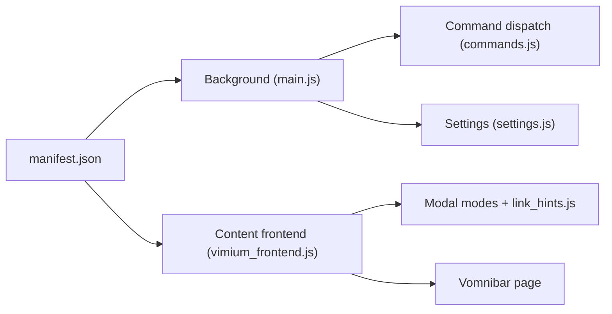

# philc/vimium

> Browser extension that lets you navigate by keyboard like in Vim, on Chrome, Edge and Firefox.

## The problem
Navigating, switching tabs and clicking links with the mouse slows down people who live on the keyboard.

## What it actually does
Injects content scripts that handle modes (normal, insert, visual, search) and display hints on links to activate them from the keyboard. A background script runs privileged commands: tabs, global marks, URL exclusions. The Vomnibar bar searches bookmarks, history and tabs. Shortcuts can be remapped on the options page.

## How it is wired


## Trying it
```bash
# Pas de commande : installation depuis le Chrome Web Store, Edge Add-ons ou Firefox Add-ons.
# Ensuite taper ? pour afficher la liste des raccourcis.
```

## Cost and gotchas
Free. Requires broad extension permissions (pages, tabs, history). For the browser's new tab pages, a companion extension is needed. 893 open issues.

## What it is not
It is not a development or data tool. It has no server; settings stay in the browser.

## Alternatives
- No alternative named in the README.

## For you
Watch: a comfort gain for those who read a lot of documentation, unrelated to data/AI pipelines.
